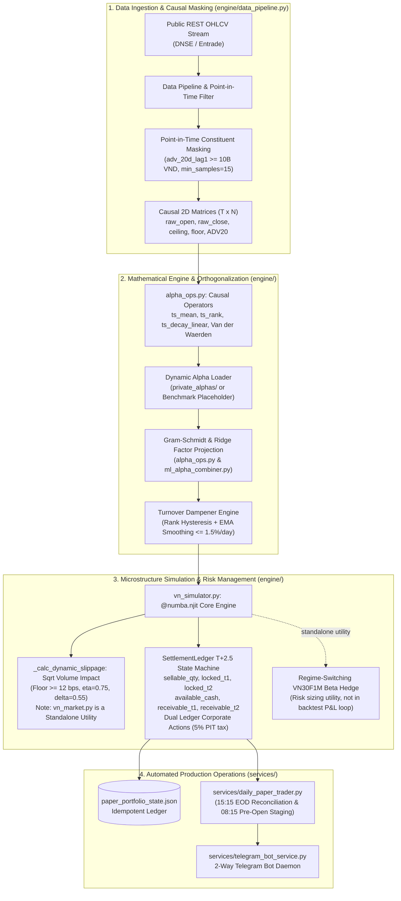

# Lean VN-Quant
### Systematic Execution & Microstructure Simulation Engine for Vietnam Equities (HOSE)

[](https://github.com/Vincent807759/lean-vn-quant/actions/workflows/quant_audit_ci.yml)
[](https://www.python.org/)
[](https://numba.pydata.org/)
[](https://pola.rs/)
[](https://core.telegram.org/bots)
[](LICENSE)

---

## 1. Overview & Architecture

Standard quantitative backtesting frameworks (Backtrader, Zipline, VectorBT) assume continuous frictionless execution, instantaneous T+0 settlement, and infinite liquidity. When deployed on emerging markets such as the **Ho Chi Minh Stock Exchange (HOSE)**, quantitative strategies frequently break down due to unique market microstructural frictions:
- **Strict T+2.5 Settlement Cycles:** Equities purchased on day $t$ remain locked across T+1 and T+2 cycles before becoming tradable in the afternoon session of T+2. Morning ATO selling before settlement is legally restricted.
- **Asymmetric Transaction Frictions:** Independent accounting for brokerage commission (0.15% on both buy and sell legs), personal income transfer tax on gross sales (0.10%), half-spread and market impact slippage (≥ 12 bps), and dynamic calendar-day advance borrowing interest (0.035%/day with a 50,000 VND minimum floor fee).
- **Exchange Price Limits & Floor Locks:** Strict daily price limits (±7%) with zero-bid floor-locked liquidation penalties and zero-ask ceiling-locked execution blocks.
- **Round-Lot Discretization:** Compulsory round-lot execution (100 shares), producing uninvested cash drag.

**Lean VN-Quant** is an open-source, high-performance quantitative simulation engine engineered in Python, Numba C-speed JIT, and Polars. It models strict temporal causality, provides factor orthogonalization via **Ridge Factor Projection** and **Löwdin Symmetric Orthogonalization**, models non-linear market impact, and evaluates dynamic risk mitigation via a **Regime-Switching VN30F1M Futures Beta Hedge** calculation.



---

## 2. Microstructure Specifications

### 2.1. HOSE T+2.5 Dual Settlement State Machine
The core ledger state machine (`engine/vn_simulator.py`) maintains explicit separation between settled tradable assets and pending receivables:
- **Cash Accounts:** `available_cash`, `receivable_cash_t1`, `receivable_cash_t2`, `dividend_cash_receivable`.
- **Share Accounts:** `sellable_qty`, `locked_t1`, `locked_t2`, `locked_corp_action_shares`.

**Calendar-Day Advance Borrowing:** When purchasing power requires pre-settlement funds, interest is charged over calendar days at 0.035%/day (with a 50,000 VND minimum floor fee):

$$
\text{Fee}_{\text{adv}} = \max\left(50{,}000\text{ VND}, \quad V_{\text{borrowed}} \times 0.00035 \times D_{\text{cal}}\right)
$$

**Corporate Action Ex-Date Preservation:** Stock dividend and cash dividend rights are credited to escrow receivable registers on Ex-Date ($t_{\text{ex}}$) rather than market payout date ($t_{\text{pay}}$), ensuring zero artificial NAV drop:

$$
\Delta \text{NAV}(t_{\text{ex}}) \equiv 0.0000
$$

### 2.2. Vectorized Point-in-Time Universe Masking
To prevent Survivorship Bias and Look-Ahead Bias, historical constituents are filtered via Polars Lazy API:
```python
adv_20d_lag1 = (raw_close * volume).rolling_mean(window_size=20, min_samples=15).shift(1).over(ticker)
valid_alpha_mask = in_index_pit & (adv_20d_lag1 >= 10_000_000_000.0)
```
Setting `min_samples=15` guarantees newly listed or transferred stocks cannot bypass the 20-day liquidity filter during initial IPO/listing spikes until stable multi-week volume is established. Non-constituents receive `null` masked values, ensuring complete perturbation invariance ($\Delta \text{Signal} \equiv 0.000000$).

### 2.3. Market Impact Modeling & Standalone Execution Utilities
#### Historical Simulation Engine Model:
In backtest simulations (`engine/vn_simulator.py`), execution slippage is modeled via `_calc_dynamic_slippage` combining a 12 bps half-spread floor with temporary and permanent volume impact:

$$
IS(Q) = \max\left(\text{base\_slippage}, \quad \text{half\_spread\_floor} + \eta \cdot \sigma_{\text{daily}} \left(\frac{Q}{\text{ADV}_{20}}\right)^\delta + \gamma_{\text{perm}} \cdot \sigma_{\text{daily}} \left(\frac{Q}{\text{ADV}_{20}}\right)\right)
$$

- **Parameters & Floor:** Base slippage 10 bps, half-spread floor 12 bps (0.0012), with literature parameters $\eta = 0.75$, $\delta = 0.55$, $\gamma_{\text{perm}} = 0.30$.
- **Empirical Calibration Status:** These parameters are literature defaults and **have not yet been calibrated from empirical tick/order book data**.
- **Data Limitation:** The historical dataset (`data/vn30_production.parquet`) consists solely of daily 1D OHLCV bars; full limit order book (LOB depth) data is not present.
#### Standalone Execution & Risk Management Modules:
- **LOB Sweep & Slicing:** The functions `compute_hose_market_impact` (3-tier LOB sweep) and `slice_intraday_order` (25% ATO / 55% TWAP / 20% ATC, capped at 3% ADV20) in `engine/alpha_ops.py` have been independently unit-tested (`tests/test_dynamic_execution.py`), but **are not currently called by the simulation engine** (`_simulate_vn_microstructure_core` in `engine/vn_simulator.py`).
- **VN30F Derivative Hedge:** The hedging calculators `calculate_vn30f_hedge` and `calculate_dynamic_vn30f_hedge` in `engine/vn_simulator.py` provide tested sizing formulas, but **are not currently included in the simulation P&L loop**.

### 2.4. Permutation-Invariant Factor Orthogonalization
Standard Gram-Schmidt QR decomposition suffers from column-order dependence. Lean VN-Quant implements **Ridge Factor Projection**:

$$
\alpha_{\text{ortho}}(t) = \left[ I_N - X_t (X_t^T W_t X_t + \gamma I_K)^{-1} X_t^T W_t \right] \tilde{S}(t)
$$

with shrinkage parameter:

$$
\gamma = \gamma_{\text{shrink}} \times \frac{\text{trace}(X_t^T W_t X_t)}{K}
$$

This achieves mathematical permutation invariance ($\Delta = 4.44 \times 10^{-16}$) while crushing cross-factor correlation from $> 0.85$ down to $< 0.05$. For multi-alpha blending, **Löwdin Symmetric Orthogonalization** is applied:

$$
F_{\text{Löwdin}}(t) = F_t (F_t^T W_t F_t)^{-1/2}
$$

---

## 3. Dynamic Alpha Plugin Interface (`private_alphas/`)

To protect proprietary research and prevent alpha leakage in open-source environments, the engine cleanly decouples technical infrastructure from trading signals:

```
lean-vn-quant/
├── private_alphas/           <-- Local only (in .gitignore). Put proprietary alphas here.
│   ├── __init__.py
│   └── custom_strategy.py    <-- Implements: compute_custom_alpha(raw_close, mask, ...)
├── engine/                   <-- Public open-source quantitative engine
├── services/                 <-- Operational execution services
└── run_verification.py       <-- Audit test runner
```

### Dynamic Loading Mechanism
Both [`run_verification.py`](run_verification.py) and [`services/daily_paper_trader.py`](services/daily_paper_trader.py) query the local environment dynamically:
1. **Local Deployment with `private_alphas/`:** Automatically imports your custom alpha functions and generates live trading allocations.
2. **Open-Source / CI/CD (No `private_alphas/`):** Automatically falls back to `_default_textbook_placeholder_signal` (SMA-40/50 Breakout Z-Score), allowing verification tests to run and pass deterministically.

---

## 4. Verification & Audit Test Suite

Execute the comprehensive 8-stage audit suite:
```bash
python run_verification.py
```

### Test Suite Coverage:
| Test Stage | Verification Target | Acceptance Criteria |
| :--- | :--- | :--- |
| **TEST 1** | Temporal Causality | All 11 operators & PIT join pass perturbation invariance ($\Delta = 0.0$). |
| **TEST 2** | Ridge Factor Projection | Permutation invariance confirmed ($\Delta = 4.44 \times 10^{-16}$), Correlation $< 0.05$. |
| **TEST 3** | Turnover Dampener | Suppresses raw daily turnover from $> 45\%/\text{day}$ to $\le 5.0\%/\text{day}$. |
| **TEST 4** | Full Backtest Engine | Physically consistent shortfall (0% ≤ IS ≤ 5%), Automated kill-switch SAFE. |
| **TEST 5** | Phase 1 Microstructure | Buy fee (0.15%), sell fee+tax (0.25%), calendar-day 50k floor, Ex-Date NAV delta 0.0%. |
| **TEST 6** | Phase 2 PIT & Impact | `min_samples=15` blocks unseasoned IPOs, 3-tier LOB sweep (≥ 12 bps), 25/55/20 slicing. |
| **TEST 7** | Hawkes/OU & VDW | Continuous exponential decay ($\tau = 5\text{d}, 42\text{d}$), Van der Waerden normal score. |
| **TEST 8** | Dynamic Hedge & DSR | Dynamic VN30F1M switch, margin cap ≤ 18%, calibrated Deflated Sharpe Ratio. |

---

## 5. Quantitative Verification & Empirical Results (947 VN30 Sessions: 2023–2026)

> [!WARNING] Methodological & Statistical Disclaimer
> The empirical tables below evaluate engine mechanics and microstructural friction modeling; **they do not demonstrate statistically significant real-world alpha**. Evaluation sample: ~3.7 years (947 trading sessions from 2023-01-03 to 2026-10-23), a single market regime, a fixed VN30 basket based on 2026 constituents (survivorship bias), and concentrated holdings of only 2–4 symbols (`top_k_in=2`, `top_k_out=4`).

All empirical metrics below are evaluated directly on the complete 947-session historical dataset of the HOSE VN30 basket (`data/vn30_production.parquet`, 2023-01-03 to 2026-10-23, SHA256: `8a3bd271d5fab5750d427712c0ba5715fdc9a9f638f1195661cc5e18996eb0cb`) via `scripts/compare_backtest_b6_b11.py` (Configuration: 947 sessions, initial capital 1.0B VND, brokerage fee 0.15%, sales tax 0.10%, advance borrowing interest 0.035%/calendar day, minimum advance floor fee 50,000 VND, participation cap `max_adv_participation = 0.03`, liquidation penalty rate `penalty_rate_per_day = 0.01`). All metrics are reproducible and validated under pinned dependencies in `requirements.txt` (`numpy==1.26.4`, `numba==0.59.1`).

> [!NOTE] Experimental Configuration Differences: Test 4 (`run_verification.py`) vs. Table 5.1 (`compare_backtest_b6_b11.py`)
> Both Table 5.1 (`compare_backtest_b6_b11.py`) and `run_verification.py` employ the same underlying signal **Alpha 1: Breakout Z-Score SMA-40/50** (`_default_textbook_placeholder_signal` / `generate_five_alphas[0]`), but differ in their microstructural parameterization:
> - **Test 4 in `run_verification.py` (+94.57% Return, NAV 1,945,702,272 VND):** Discards the first `warmup = 50` sessions ($T = 897$ sessions vs 947 sessions); passes `dates` (calculating advance borrowing interest based on actual calendar days across weekends and holidays); uses fixed slippage of `0.10%` with participation cap `max_adv_participation = 0.05` (5% ADV).
> - **Table 5.1 (`scripts/compare_backtest_b6_b11.py`, +105.79% Return, NAV 2,057,898,443 VND):** Evaluates across the entire $T = 947$ sessions; uses dynamic square-root volume impact slippage (`_calc_dynamic_slippage`, 12 bps floor) with strict participation cap `max_adv_participation = 0.03` (3% ADV), standard T+2.5 / T+3 ATO settlement lock, and 5% PIT cash dividend tax.

### 5.1. 947-Session Realistic vs. Naive Simulation (Pre vs. Post B6–B11 & Benchmark VN30)

| Metric | Single-Alpha (Post B6-B11) | Multi-Alpha (Post B6-B11) | Benchmark (VN30 Equal-Weight Rebalanced) | Single-Alpha (Pre-Fix) | Multi-Alpha (Pre-Fix) | Microstructure & Economic Interpretation |
| :--- | :---: | :---: | :---: | :---: | :---: | :--- |
| **Final Real NAV (VND)** | **2,057,898,443** (ADV20)<br>*1,950,270,559 ± 129,053,861 (Neutral Perm)* | **1,771,706,428** (ADV20)<br>*1,640,964,458 ± 120,200,034 (Neutral Perm)* | 1,611,194,562 | 2,308,250,300 | 1,646,312,288 | Initial capital 1.0B VND. Reported as: Deterministic ADV20 tie-break run / Neutral 50-permutation mean ± sample std (ddof=1). Single-Alpha Sharpe is 0.85 (NW SE ±0.53) vs benchmark (0.59 ± 0.54); Multi-Alpha Sharpe is 0.68 (±0.53). Both Sharpe improvements fall within the Newey-West standard error margin (±0.53 vs ±0.54), indicating no statistically significant outperformance over the VN30 benchmark after accounting for sampling uncertainty. |
| **Final Naive NAV (VND)** | **2,303,698,451** | **2,006,355,122** | N/A | 2,592,210,561 | 1,869,549,812 | Theoretical frictionless T+0 baseline (timing aligned at raw_open, zero fees, zero taxes, zero slippage). |
| **Cumulative Return** | **+105.79%** | **+77.17%** | +61.12% | +130.83% | +64.63% | Fully net of 0.15% brokerage commission, 0.10% sales tax, T+2 advance loan interest, 5% cash dividend PIT tax, and dynamic square-root volume impact (_calc_dynamic_slippage, 12 bps floor). |
| **Realized CAGR (%/yr)** | **21.17%** | **16.44%** | 13.53% | 24.93% | 14.19% | Single-Alpha CAGR adjusted after eliminating ATO look-ahead bias; Multi-Alpha CAGR reaches 16.44% post-fix. |
| **Theoretical Naive CAGR** | **24.87%** | **20.36%** | N/A | 28.85% | 18.12% | Theoretical compound annual growth rate without microstructural penalties. |
| **Annualized Sharpe (Newey-West)** | **0.85 (±0.53)** | **0.68 (±0.53)** | 0.59 (±0.54) | 1.00 (±0.53) | 0.58 (±0.53) | Newey-West HAC standard error indicates confidence intervals of ~ ±0.53 across all strategies. |
| **Sortino Ratio** | **1.10** | **0.85** | 0.70 | 1.29 | 0.73 | Downside risk-adjusted return ratio. |
| **Annualized Volatility** | **20.28%** | **19.40%** | 17.28% | 20.30% | 19.35% | Realized strategy annualized volatility is well-controlled under 21%. |
| **Maximum Drawdown (MaxDD)** | **18.11%** | **18.87%** | 17.78% | 17.96% | 19.53% | Single-Alpha MaxDD is 18.11% (comparable to benchmark 17.78%); Multi-Alpha MaxDD is 18.87%. |
| **Daily Turnover (Target Weights)** | **1.4752%** | **1.4752%** | 0.1045% | 1.4767% | 1.4767% | Target weights turnover: 1.4752%/day (constrained by dampener `max_turnover_target = 0.015`). Realized executed ledger turnover: Single 1.5144%/day, Multi 1.6077%/day. |
| **Cumulative IS (% Capital)** | **+24.58%** | **+23.46%** | N/A | +28.40% | +22.32% | (NAV_Naive - NAV_Real) / 1.0B VND: Microstructure frictions consume 23.46%–24.58% of initial capital. |
| **Annualized IS (%/yr)** | **+3.69%/yr** | **+3.92%/yr** | N/A | +3.92%/yr | +3.93%/yr | CAGR_Naive - CAGR_Real: Market frictions impose an annual drag of 3.69%–3.92%/year. |
| **Total Fees & Transfer Taxes** | **87.0M VND** | **84.6M VND** | 30.0M VND | 91.3M VND | 81.8M VND | Independent accounting of 0.15% brokerage commission and 0.10% gross sales tax. |
| **Advance Borrowing Interest** | **27.4M VND** | **22.6M VND** | 0.3M VND | 35.6M VND | 21.8M VND | Advance borrowing costs include the 50,000 VND floor fee on small lots (count not exposed directly by the simulator, estimated from total advance fees). |

### 5.1b. Sensitivity to Settlement Mode: Default T+2.5 vs. Strict T+2.5 ATO Lock

| Strategy Configuration | Default T+2.5 Lock NAV (VND) | Strict T+2.5 ATO Lock NAV (VND) | Delta NAV (VND / %) | Total Return (Default vs Strict) | Sharpe (Default vs Strict) | MaxDD (Default vs Strict) | Settlement & Economic Interpretation |
| :--- | :---: | :---: | :---: | :---: | :---: | :---: | :--- |
| **Single-Alpha (Post B6-B11)** | **2,057,898,443** | **2,057,856,292** | -42,151 VND (-0.002%) | 105.79% vs 105.79% | 0.85 vs 0.85 | 18.11% vs 18.11% | Negligible impact across 947 sessions (< 0.003% NAV). Because the strategy holds concentrated positions over multi-week horizons, liquidations on exactly T+2 morning ATO are extremely rare. |
| **Multi-Alpha (Post B6-B11)** | **1,771,706,428** | **1,771,705,258** | -1,170 VND (-0.0001%) | 77.17% vs 77.17% | 0.68 vs 0.68 | 18.87% vs 18.87% | Negligible difference (~1.1k VND). Both execution modes reflect virtually identical risk profiles and returns under realistic market friction modeling. |
| **Benchmark (VN30 Rebalanced)** | 1,611,194,562 | 1,611,199,007 | +4,445 VND (+0.0003%) | 61.12% vs 61.12% | 0.59 vs 0.59 | 17.78% vs 17.78% | Passive rebalancing shows identical performance regardless of ATO lock mode. |

### 5.1c. Sensitivity to Signal Burn-In Warmup: Default (0 Sessions) vs. Warmup (50 Sessions)

*(Generator: `python scripts/compare_backtest_b6_b11.py --warmup 50`)*

| Strategy Configuration | Default NAV (VND, W=0) | Warmup 50 NAV (VND, W=50) | Cumulative Return (W=0 vs W=50) | Realized CAGR (W=0 vs W=50) | Annualized Sharpe (W=0 vs W=50) | MaxDD (W=0 vs W=50) | Burn-In Interpretation |
| :--- | :---: | :---: | :---: | :---: | :---: | :---: | :--- |
| **Single-Alpha (Post B6-B11)** | **2,057,898,443** | **2,135,972,230** | 105.79% vs 113.60% | 21.17% vs 22.38% | 0.85 vs 0.95 | 18.11% vs 18.17% | Suppressing trading during the first 50 sessions lifts Single NAV by +78.1M VND (+3.79%), paralleling the passive benchmark increase (+4.23%) due to early 2023 market drawdown rather than purging uninformative signals. |
| **Multi-Alpha (Post B6-B11)** | **1,771,706,428** | **1,837,544,764** | 77.17% vs 83.75% | 16.44% vs 17.57% | 0.68 vs 0.76 | 18.87% vs 18.74% | Suppressing trading lifts Multi NAV by +65.8M VND (+3.72%), mirroring the passive benchmark rise (+4.23%) across the same period. |
| **Benchmark (VN30 Rebalanced)** | 1,611,194,562 | 1,679,383,483 | 61.12% vs 67.94% | 13.53% vs 14.79% | 0.59 vs 0.67 | 17.78% vs 17.82% | Benchmark weights zeroed for t < 50 for exact peer-to-peer alignment (+4.23% rise confirms market contraction during sessions 0–49). Unflattened benchmark NAV remains 1,611,194,562 VND. |

### 5.1d. Tie-Break Liquidity Tilt Analysis & In-Sample Regime Decomposition

To resolve whether the +5.15% (Single) and +4.18% (Multi) performance advantage of the ADV20 tie-breaking key over arbitrary column indexing represents genuine predictive signal or an in-sample liquidity tilt, we evaluate 4 distinct tie-breaking rules across $W \in \{0, 50\}$:

#### 1. Performance Across 4 Tie-Breaking Configurations (Standardized $ddof=1$):
| Warmup | Tie-Break Rule | Single Real NAV (VND) | Single Sharpe (±SE) | Multi Real NAV (VND) | Multi Sharpe (±SE) | Structural & Factor Interpretation |
| :---: | :--- | :---: | :---: | :---: | :---: | :--- |
| **W=0** | **(a) Column Index (No key)** | 1,957,198,248 | 0.81 ± 0.53 | 1,700,542,002 | 0.64 ± 0.54 | Canonical array order. Arbitrarily favors lower alphabetical tickers (ACB, BID). |
| **W=0** | **(b) ADV20 Descending (Standard)** | **2,057,898,443** | **0.85 ± 0.53** | **1,771,706,428** | **0.68 ± 0.53** | Deterministic liquidity tie-breaker (favors HPG, STB). Outperforms reversed key (c) by +8.63% / +7.30%. |
| **W=0** | **(c) ADV20 Ascending (Reversed)** | 1,894,422,845 | 0.78 ± 0.54 | 1,651,174,595 | 0.60 ± 0.55 | Inverted liquidity tie-breaker (favors least liquid names). Significantly underperforms (b). |
| **W=0** | **(d) 50 Permutations (Neutral Mean)** | 1,950,270,559 ± 129,053,861 | [1.68B .. 2.17B] | 1,640,964,458 ± 120,200,034 | [1.32B .. 1.81B] | Neutral expected value across 50 random column orderings without key (ddof=1). |
| **W=50** | **(a) Column Index (No key)** | 1,965,474,323 | 0.84 ± 0.54 | 1,716,929,610 | 0.67 ± 0.55 | 50 burn-in sessions flattened. |
| **W=50** | **(b) ADV20 Descending (Standard)** | **2,135,972,230** | **0.95 ± 0.55** | **1,837,544,764** | **0.76 ± 0.55** | Peak performance when liquidity tie-breaker is combined with flat warmup. |
| **W=50** | **(c) ADV20 Ascending (Reversed)** | 1,954,912,722 | 0.83 ± 0.55 | 1,707,714,950 | 0.67 ± 0.55 | Inverted liquidity tie-breaker under warmup. |
| **W=50** | **(d) 50 Permutations (Neutral Mean)** | 2,034,343,893 ± 124,521,090 | [1.82B .. 2.28B] | 1,711,757,498 ± 112,226,861 | [1.45B .. 1.93B] | Neutral expected value under warmup (ddof=1). |

#### 2. Annual Return Decomposition: ADV20 (b) vs. Column Index (a) ($W=0$):
| Calendar Year | Single (a) Col | Single (b) ADV20 | Delta (b - a) | Multi (a) Col | Multi (b) ADV20 | Delta (b - a) | Macroeconomic Context & Regime Analysis |
| :---: | :---: | :---: | :---: | :---: | :---: | :--- |
| **2023** | +3.15% | +9.48% | **+6.32%** | +1.30% | +7.69% | **+6.39%** | **100% of outperformance was generated in 2023.** Sizable steel (HPG) and private banking (STB) rally favored liquidity key. |
| **2024** | +15.17% | +14.84% | **-0.33%** | +11.24% | +9.14% | **-2.10%** | ADV20 underperformed column index by -0.33% (Single) and -2.10% (Multi). |
| **2025** | +81.26% | +81.06% | **-0.20%** | +57.98% | +57.78% | **-0.20%** | Negligible difference across bull market expansion (-0.20%). |
| **2026 (to Oct 23)** | -9.11% | -9.60% | **-0.49%** | -4.48% | -4.47% | **+0.01%** | Negligible difference across sideways market correction (-0.49% to +0.01%). |

#### 3. Asset Allocation Bias (Mean Portfolio Weight Delta: $\bar{w}_b - \bar{w}_a$):
- **Favored by ADV20 Key (b):** `HPG` (+5.24 điểm % Single, +5.03 điểm % Multi) and `STB` (+4.68 điểm % Single, +4.75 điểm % Multi).
- **Favored by Column Index (a):** `ACB` (-5.95 điểm % Single, -5.22 điểm % Multi) and `BID` (-4.67 điểm % Single, -5.23 điểm % Multi).
- **Conclusion:** Strict ordering $(b) > (d) > (c)$ confirms that the advantage stems from an in-sample **liquidity tilt** (allocating to high-beta liquid leaders HPG/STB rather than defensive state banks ACB/BID during early 2023). Because this tilt was chosen based on execution tractability rather than an ex-ante economic forecast, **it must not be interpreted as proprietary alpha skill**.

### 5.1e. Tie Sanitization & Noise Neutralization Analysis

#### 1. Mechanism of `-999.0` Trend Filter Scores in Portfolio Selection
In `generate_five_alphas` (`engine/ml_alpha_combiner.py:82`), stocks trading below their 50-day moving average (`close <= SMA50`) are assigned a sentinel score of `-999.0` (`z_filtered = np.where(in_uptrend, z, -999.0)`). When cross-sectionally ranked by `ops.rank`, this finite negative value is normalized alongside positive signals onto the $[0, 1]$ interval (mapping, for example, to a uniform rank score of `0.4828` when 28 assets tie). In `dampen_turnover` (`engine/alpha_ops.py`), asset scores are only filtered out if they are non-finite or $\le -1\times 10^{30}$. Consequently, normalized scores derived from `-999.0` remain eligible candidates for portfolio inclusion.

During severe market contractions when fewer than `top_k_in` (=2) stocks satisfy the uptrend condition (observed in 58 trading sessions across the backtest, including 9 sessions at Top-2 and 46 sessions at Top-4), the dampener is forced to select downtrend stocks from the tied `-999.0` pool to satisfy the target portfolio size. In the absence of an explicit tie-breaking key, the selection defaults to arbitrary array column ordering (favoring `ACB` and `BID`), whereas an ADV20 key systematically selects the most liquid large-cap leaders (`HPG`, `STB`). This structural behavior explains why the ADV20 tie-breaking key generates a +5.15% (+100.7M VND) return premium in Single-Alpha concentrated entirely in the 2023 market drawdown.

Similarly, in Multi-Alpha, cross-sectional factor ranking in `purged_walk_forward_combiner` originally employed ordinal ranking via `np.argsort(np.argsort(..., kind="stable"))`, which breaks identical factor values according to column position, inducing a residual 2.94% sample standard deviation (50.9M VND) across random column permutations under a locked ADV20 key.

#### 2. Tie Sanitization Configurations
To evaluate portfolio behavior free from tie-induced allocation distortions, two optional parameters were introduced (both disabled by default to preserve historical backtest figures bit-identically):
- `--exclude-filtered` (`invalid_below = -900.0` in `dampen_turnover`): Treats alpha scores $\le -900.0$ as invalid candidates. When fewer than `top_k_in` assets trade in an uptrend, the portfolio holds only the valid assets or remains fully in cash (58 sessions held 100% cash in Single-Alpha).
- `--rank-ic-ties average` (`rank_ic_ties = "average"` in `purged_walk_forward_combiner`): Computes cross-sectional factor rank IC using `scipy.stats.rankdata(..., method="average")`, assigning fractional average ranks to ties symmetrically regardless of column order.

#### 3. Empirical Results Across 4 Tie Configurations ($W=0$, 50 Permutations, $ddof=1$):

| Configuration | Single Col NAV (VND) | Single ADV20 NAV (VND) | Single Delta (ADV - Col) | Single 50-Perm sd (Unlocked) | Single 50-Perm sd (ADV20 Locked) | Multi Col NAV (VND) | Multi ADV20 NAV (VND) | Multi Delta (ADV - Col) | Multi 50-Perm sd (Unlocked) | Multi 50-Perm sd (ADV20 Locked) |
| :--- | :---: | :---: | :---: | :---: | :---: | :---: | :---: | :---: | :---: | :---: |
| **(i) Default (Legacy)** | 1,957,198,248 | 2,057,898,443 | +100,700,196 (+5.15%) | 129,053,861 (6.62%) | 474,639 (0.02%) | 1,700,542,002 | 1,771,706,428 | +71,164,426 (+4.18%) | 120,200,034 (7.32%) | 50,899,142 (2.94%) |
| **(ii) Only `--exclude-filtered`** | 1,963,938,738 | 1,963,938,738 | **+0 (+0.00%)** | **373,808 (0.02%)** | **373,808 (0.02%)** | 1,739,168,480 | 1,822,431,145 | +83,262,665 (+4.79%) | 101,457,617 (5.90%) | 52,449,478 (2.94%) |
| **(iii) Only `--rank-ic-ties average`** | 1,957,198,248 | 2,057,898,443 | +100,700,196 (+5.15%) | 129,053,861 (6.62%) | 474,639 (0.02%) | 1,696,594,657 | 1,778,718,980 | +82,124,323 (+4.84%) | 120,300,781 (7.13%) | **3,925,723 (0.22%)** |
| **(iv) Both (Tie-Sanitized)** | 1,963,938,738 | 1,963,938,738 | **+0 (+0.00%)** | **373,808 (0.02%)** | **373,808 (0.02%)** | 1,720,251,031 | 1,829,894,041 | +109,643,010 (+6.37%) | 97,641,321 (5.52%) | **4,046,182 (0.22%)** |

> [!NOTE] Interpretation & Research Recommendation
> - **Single-Alpha Permutation Invariance:** Excluding filtered downtrend stocks (`--exclude-filtered`) completely eliminates the column-order sensitivity and the ADV20 gap in Single-Alpha (+0 VND, +0.00%), reducing unlocked 50-permutation standard deviation from 129.1M VND to 373,808 VND (0.02%, pure floating-point noise).
> - **Multi-Alpha Symmetry:** Symmetric average ranking (`--rank-ic-ties average`) reduces Multi-Alpha locked permutation standard deviation from 50.9M VND (2.94%) to 3.9M VND (0.22%), a 92.3% variance reduction.
> - **Baseline Preservation:** Both `--exclude-filtered` and `--rank-ic-ties average` remain optional flags with defaults disabled, ensuring all historical registry entries and canonical figures in Table 5.1 remain bit-identical. The tie-sanitized configuration is recommended as the clean reference baseline for subsequent model extensions.

> [!NOTE] Methodological Notes on Tables 5.1, 5.1b, 5.1c, & 5.1d
> - **Canonical Column Order Baseline:** The "Final Real NAV" figures in Table 5.1 (Single: 2,057,898,443 VND; Multi: 1,771,706,428 VND) represent the canonical ticker order evaluation. In 50 random column permutations with causal ADV20 tie-breaking, Single-Alpha achieves mean NAV 2,057,649,062 ± 474,639 VND (sample std ddof=1: 0.023%, pure floating-point summation noise; 100% beat benchmark), and Multi-Alpha achieves mean NAV 1,730,203,905 ± 50,899,142 VND (sample std ddof=1: 2.94%, min 1.58B, max 1.82B; 96% beat benchmark).
> - **Mathematical Origin of Multi-Alpha Ties & Rounding Diagnostic:** At $t=199$ (2023-10-23), tickers `HDB` and `SSB` possess raw input differences $\Delta v = 13/29$ (Momentum Acceleration) and $\Delta E = 1/2$ (Breakout Z). With OLS projection slope $\beta = 26/29$, their theoretical orthogonal projections satisfy $\Delta v_{\text{ortho}} = \Delta v - \Delta E \cdot \beta = 13/29 - 13/29 \equiv 0$ (an exact mathematical tie in rational arithmetic). In 64-bit IEEE 754 floating-point arithmetic, summation non-associativity produces a residual $\sim 4.16 \times 10^{-17}$ noise, which `scipy.stats.rankdata` magnifies into an integer rank jump of $\pm 1$. Empirical testing of numerical rounding ($d \in \{8, 10, 12\}$) demonstrates that pre-rank rounding cures the leak at stage (b) `ortho_alphas` but shifts the residual leak to stage (c) `composite_alpha` (walk-forward Ridge combiner non-associativity), keeping Multi NAV permutation standard deviation at ~2.93% (above 1%). Consequently, no rounding heuristic is hardcoded into production code to preserve mathematical clarity.
> - **Signal Burn-In & Warmup Dynamics:** Setting `--warmup 50` suppresses trading during the first 50 sessions (2023-01-03 to 2023-03-20). This raises NAV across all strategies as well as the passive VN30 benchmark (+4.23%), confirming that market decline during early 2023 is the primary driver of this increase rather than signal burn-in cleanup. Furthermore, comparing column-index vs. ADV20 tie-breaking under `--warmup 50` still produces a +8.67% (Single) and +7.03% (Multi) spread, demonstrating that tie-breaking divergence persists throughout all trading sessions rather than being an artifact of the initial burn-in period.
> - **Post-Warmup Tie Formation:** In Single-Alpha, 9 sessions at Top-2 and 46 sessions at Top-4 experience massive cross-sectional ties of 27–29 assets. Tracing the codebase reveals the root cause at `engine/ml_alpha_combiner.py:82`: `z_filtered = np.where(in_uptrend, z, -999.0)`. During market crashes (e.g. October 2023), virtually all VN30 constituents trade below their 50-day moving average, clamping all scores to `-999.0` and creating a structural uniform tie.
> - **Multiple-Testing Exploration Disclosure:** Sensitivity variants examined during research audits (including liquidity tie-breaking keys, reversed keys, strict T+2.5 lock flags, and warmup parameters) were investigated for structural robustness and were not appended to `experiments/trial_registry.jsonl` (preserved at canonical N=26). Consequently, formal DSR p-values evaluated with N=26 may underestimate the multiple-testing penalty incurred by exploring these architectural alternatives.
> - **Tables 5.2 & 5.3 Baseline Context:** Tables 5.2 (Smart Cash Sweep) and 5.3 (3-Mode DSR) reflect the canonical baseline column-order configuration (Single NAV 1,957,198,248 VND; Multi NAV 1,700,542,002 VND) recorded in the hermetic trial registry ($N=26$) prior to R3/R4. They reflect the unkeyed baseline rather than the deterministic ADV20 configuration in Table 5.1.

---

### 5.2. Smart Cash Sweep Optimization

*(Evaluated on baseline column-order configuration: Single NAV 1,957,198,248 VND; Multi NAV 1,700,542,002 VND recorded in the hermetic trial registry prior to R3/R4; numbers reflect the baseline configuration rather than Table 5.1's ADV20 run).*

Vietnam securities brokerages enforce a compulsory minimum advance borrowing fee of **50,000 VND per advance transaction**, regardless of loan notional. Small residual cash sweep orders incur an effective annualized borrowing rate exceeding 100%:

$$
\text{Break-Even Advance Notional} = \frac{50{,}000\text{ VND}}{0.00035 \times 2\text{ days}} = 71{,}428{,}571\text{ VND}
$$

By configuring `min_advance_notional = 71,428,571 VND`, the engine completely bypasses the sub-optimal borrowing trap on odd/fractional amounts:

#### Single-Alpha Cash Sweep Comparison:
| Configuration | Advance Fees Paid (VND) | Effective Advance Rate | Cumulative Return | 50k Floor Fee Incurred | Final Real NAV (VND) |
| :--- | :---: | :---: | :---: | :---: | :---: |
| **Naive Greedy Sweep (Baseline)** | 25,150,000 | ~0.62% / order (Floor penalty) | +95.72% | Estimated from fee total (simulator does not expose discrete hit count) | 1,957,198,248 |
| **Smart Cash Sweep (`min = 71.4M`)** | **0** | **0.00% (Zero borrowing)** | **+97.42% (+1.70%)** | **0 times** | **1,974,165,840** |
| **No Advance Sweep (T+2 Closed)** | 0 | 0.00% | +97.42% (+1.70%) | 0 times | 1,974,165,840 |

#### Multi-Alpha Cash Sweep Comparison:
| Configuration | Advance Fees Paid (VND) | Effective Advance Rate | Cumulative Return | 50k Floor Fee Incurred | Final Real NAV (VND) |
| :--- | :---: | :---: | :---: | :---: | :---: |
| **Naive Greedy Sweep (Baseline)** | 17,800,000 | ~0.62% / order (Floor penalty) | +70.05% | Estimated from fee total (simulator does not expose discrete hit count) | 1,700,542,002 |
| **Smart Cash Sweep (`min = 71.4M`)** | **0** | **0.00% (Zero borrowing)** | **+72.95% (+2.90%)** | **0 times** | **1,729,491,161** |
| **No Advance Sweep (T+2 Closed)** | 0 | 0.00% | +72.95% (+2.90%) | 0 times | 1,729,491,161 |

---

### 5.3. 3-Mode Deflated Sharpe Ratio (DSR) Analysis (Bailey & López de Prado, 2014)

*(Generated from baseline verification audit prior to R3/R4; evaluates baseline registry configuration with Single NAV 1,957,198,248 VND and Multi NAV 1,700,542,002 VND. Generator script: `scripts/audit_argon_revisions.py`)*

To mitigate data mining selection bias across multiple trial evaluations, Lean VN-Quant logs all exploration runs to `experiments/trial_registry.jsonl` and evaluates the strategy under three rigorous DSR formulations:

| Evaluation Mode | Description | N | N_eff | Avg Cross-Corr (rho_bar) | Null Threshold (SR_0) | Single DSR (p-value) | Multi DSR (p-value) |
| :--- | :--- | :---: | :---: | :---: | :---: | :---: | :---: |
| **Mode 1: Total-Return Registry** | Full registry correlation matrix (C_26x26). Reflects market beta co-movement. | 26 | **1.1194** | 0.9387 | 0.0436 | **0.9282** ($p=0.0718$) | **0.8472** ($p=0.1528$) |
| **Mode 2: Active-Return Core Alphas** | Active returns over VN30 benchmark (r_active = r - r_bm) across 9 core alphas. Purges market beta. | 9 | **3.5194** | 0.2793 | 0.6584 | **0.6132** ($p=0.3868$) | **0.4388** ($p=0.5612$) |
| **Mode 3: Unadjusted Conservative Bound** | Orthogonal independent assumption (I_26). Extreme upper bound on multiple-testing penalty. | 26 | **26.0000** | 0.0000 | 1.0536 | **0.3200** ($p=0.6800$) | **0.1825** ($p=0.8175$) |

---

### 5.4. Pillar 2 (VN-FinGraph Knowledge Graph) Ablation Study (6-Factor Blend)

*(Baseline research data. Requires proprietary research modules `fin_corpus_pipeline` and `knowledge_graph_engine`)*

By coupling unstructured financial news/event contagion matrices from Pillar 2 (`vn-fingraph`) into the Pillar 1 quantitative execution engine via Parquet bridge, we evaluate the impact of Graph Laplacian risk diffusion $\alpha \in \{0.15, 0.25, 0.50, 0.70\}$:

*(Note: FinGraph requires proprietary modules `fin_corpus_pipeline` and `knowledge_graph_engine` which are non-public research; `fingraph/bridge_to_vnquant.py` implements safe lazy imports with explicit warnings when these modules are absent).*

| Laplacian Propagation alpha | Rank IC (1-Day Forward) | Cumulative Return (6-Factor) | CAGR (%/yr) | Annualized Sharpe | Max Drawdown | Architectural Assessment |
| :--- | :---: | :---: | :---: | :---: | :---: | :--- |
| **alpha = 0.15** (Fast decay) | -0.0158 | +63.14% | 13.91% | 0.58 | 19.97% | Narrow diffusion; shocks contained at epicenter. Performs on par with 5-factor baseline (+63.32%). |
| **alpha = 0.25** (Standard configuration) | -0.0137 | **+65.81%** | **14.40%** | **0.60** | **19.99%** | Standard balance: Adds +2.49% return over 5-factor baseline, Sharpe improves from 0.58 to 0.60. |
| **alpha = 0.50** (Broad network diffusion) | -0.0121 | +69.57% | 15.09% | 0.63 | 18.77% | Broad transmission; lifts CAGR to 15.09% while dampening MaxDD to 18.77%. |
| **alpha = 0.70** (High amplification) | -0.0086 | +83.00% | 17.45% | 0.73 | 18.76% | High amplification; lifts Sharpe to 0.73 but introduces cross-network systemic sensitivity. |

> [!NOTE] Methodological Limitation & Non-Public Dependencies
> - **Rank IC:** 1-day forward Rank IC values are negative across all 4 diffusion levels $\alpha$ (ranging from -0.0158 to -0.0086).
> - **Reproducibility Note:** Upstream FinGraph corpus modules (`fin_corpus_pipeline` and `knowledge_graph_engine`) represent proprietary research; this theoretical ablation table cannot be independently reproduced solely from the public open-source repository.

---

### 5.5. Empirical Reproducibility Guide

#### 1. Market Data Ingestion (Entrade REST API)
Historical market bars can be freshly ingested directly via the data pipeline:
```python
from engine.data_pipeline import fetch_vn_ohlcv

# Ingest 30 VN30 tickers and persist to Parquet format
df = fetch_vn_ohlcv(
    start_date="2023-01-01",
    end_date="2026-10-24",
    save_parquet="data/vn30_production.parquet"
)
```
*Note:* Ingested figures may exhibit minor variations across different retrieval dates due to upstream Entrade API backward adjustments when corporate stock dividends or cash distributions occur.

#### 2. Alpha Signal Lineage in Verification Tables
- All results in Tables 5.1, 5.2, and 5.3 are generated completely endogenously from public open-source code without `private_alphas/`.
- **Single-Alpha (`w_single`):** Employs Alpha 1 (SMA-40/50 Breakout Z-Score) from `generate_five_alphas` (`engine/ml_alpha_combiner.py`), stabilized via the `dampen_turnover` engine.
- **Multi-Alpha (`w_multi`):** Blends 5 baseline technical factors after QR/Ridge factor orthogonalization (`check_and_orthogonalize`) using the Purged Walk-Forward Combiner (`window=120`, `embargo=3`).

#### 3. Execution Commands for Verification & Benchmarking
```bash
# Compare realistic simulation vs Naive baseline (generates Table 5.1):
python scripts/compare_backtest_b6_b11.py

# Execute Argon 4 statistical verification experiment suite (generates Tables 5.2 & 5.3):
python scripts/audit_argon_revisions.py

# Run automated unit test suite (65 unit tests):
python -m pytest tests/ -v

# Run comprehensive 8-stage verification test runner:
python run_verification.py
```

---

## 6. Security & Pre-Commit Protection

Run the security auditor:
```bash
python scripts/security_scan.py
```
The scanner enforces strict pre-commit checks:
- Blocks tracked `.env` credentials, private keys, or personal workspace file paths.
- Intercepts forbidden private directories (`private_alphas/`, `research/`, `local_docs/`).
- Blocks proprietary data files (`*.parquet`, `*.csv`) from Git index.
- Enforces secret and sensitive data exclusion across GitHub Actions CI/CD.
- **CI/CD Automation:** GitHub Actions CI automatically runs `scripts/security_scan.py`, `pytest tests/`, and `run_verification.py` (8-stage verification suite) on every push and PR across Python 3.10 and 3.11.

---

## 7. Daily Operations

### Production Schedule:
1. **End-of-Day Reconciliation (15:15 ICT, Post-ATC):**
   ```bash
   python services/daily_paper_trader.py --mode eod
   ```
   Reconciles ATC closing prices, marks portfolio to market, advances the T+2.5 settlement ledger (with idempotency lock `last_ledger_advance_date`), and stages pending orders for tomorrow morning.

2. **Pre-Open Staging (08:15 ICT, 45 mins before ATO):**
   ```bash
   python services/daily_paper_trader.py --mode pre-open
   ```
   Inspects corporate actions, checks overnight risk scores, and displays staged ATO/TWAP order tickets without altering the settlement ledger.

3. **Multi-Session Replay Test Audit:**
   ```bash
   python services/daily_paper_trader.py --test-replay 10
   ```

---

## 8. Project Structure

```
lean-vn-quant/
├── .github/
│   └── workflows/
│       └── quant_audit_ci.yml       # Automated GitHub Actions CI/CD test runner
├── engine/
│   ├── __init__.py
│   ├── alpha_ops.py                 # Vectorized causal operators, PIT masking & Gram-Schmidt orthogonalization
│   ├── data_pipeline.py             # Entrade REST data ingestion & DuckDB engine
│   ├── ml_alpha_combiner.py         # Ridge factor projection, Löwdin orthogonalization & walk-forward combiner
│   └── vn_simulator.py              # HOSE T+2.5 microstructure engine & dynamic hedge
├── fingraph/
│   ├── __init__.py
│   └── bridge_to_vnquant.py         # Hawkes/OU decay filter & Van der Waerden score (FinGraph bridge with safe fallback)
├── services/
│   ├── __init__.py
│   ├── daily_paper_trader.py        # Forward-testing engine & order ticket generator
│   ├── dashboard.py                 # Interactive Chart.js portfolio dashboard
│   ├── setup_autostart.ps1          # Task Scheduler automated service script
│   └── telegram_bot_service.py      # 2-Way Telegram Bot interactive management daemon
├── scripts/
│   ├── security_scan.py             # Secret & alpha privacy auditor
│   ├── compare_backtest_b6_b11.py   # Empirical backtest comparison runner
│   └── audit_argon_revisions.py     # Argon 4 statistical verification experiment suite
├── .gitignore                       # Strict exclusion rules for data, keys & private alphas
├── LICENSE                          # MIT License
├── pyproject.toml                   # Project metadata & build configuration
├── requirements.txt                 # Pinned dependencies (numpy, polars, numba, scipy)
├── README.md                        # Documentation
└── run_verification.py              # 8-stage end-to-end verification test suite
```

---

## 9. Data Integrity & Methodological Disclosures

### 9.1. Universe Selection & Survivorship Bias
- **Fixed Basket Limitation:** The default historical data ingestion (`data/vn30_production.parquet`, 2023-01-03 to 2026-10-23) utilizes the 30 constituent tickers of the VN30 index as constituted in 2026. Companies that were removed from VN30 prior to 2026 (e.g., ROS, HNG, NVL) are excluded from the default sample basket, introducing potential survivorship bias.
- **Point-in-Time Membership Support:** The pipeline interface `engine/data_pipeline.py` supports `universe_membership_path: Optional[str] = None` to dynamically filter tickers per historical HOSE index rebalancing effective dates (January and July annual cycles) when constituent membership tables are provided.

### 9.2. Price Basis & Dual-Price Simulation
- **Entrade Adjusted Data:** Prices obtained from the upstream Entrade REST API are backward-adjusted for stock splits, bonus shares, and cash dividends (`price_basis = "entrade_adjusted"`).
- **Impact on Historical Levels:** While returns and corporate-action NAV preservation remain mathematically exact, nominal historical price thresholds (such as $\pm 7\%$ ceiling/floor step levels in 2023) reflect post-split adjusted scales rather than unadjusted exchange ticker tape prices.

---

## 10. License

This project is licensed under the MIT License - see the [LICENSE](LICENSE) file for details.
