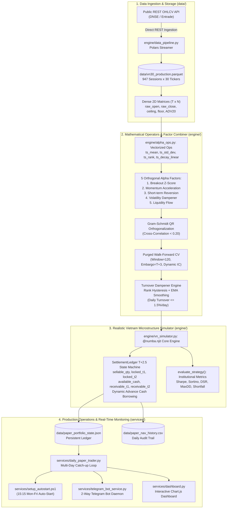

# Lean VN-Quant
### Systematic Quantitative Execution & Microstructure Engine for Vietnam Equities (VN30)

[](https://github.com/Vincent807759/lean-vn-quant/actions/workflows/quant_audit_ci.yml)
[](https://www.python.org/)
[](https://numba.pydata.org/)
[](https://pola.rs/)
[](https://core.telegram.org/bots)
[](https://www.chartjs.org/)
[](https://opensource.org/licenses/MIT)

---

## 1. Executive Summary

Standard quantitative backtesting frameworks (e.g., Backtrader, Zipline, VectorBT) assume continuous frictionless execution, instantaneous settlement ($T+0$), and infinite liquidity. When deployed on emerging markets such as the **Ho Chi Minh Stock Exchange (HOSE)**, theoretical strategies suffer severe degradation due to unique market microstructural frictions:
- **Strict $T+2.5$ Settlement Lag:** Stocks purchased on day $T$ settle and become tradable in the afternoon session of day $T+2$. Morning ATO selling before settlement is legally restricted.
- **Asymmetric Transaction Frictions:** Round-trip brokerage commission ($0.15\%$ per leg), personal income tax on gross sales ($0.10\%$), execution slippage ($0.10\%$), and dynamic $T+2$ sales proceeds advance borrowing interest ($0.035\%/\text{day}$).
- **Exchange Price Limits & Liquidity Traps:** Strict $\pm 7\%$ daily price bands with zero-bid (floor trapped) and zero-ask (ceiling locked) liquidity phenomena.
- **Odd-Lot Discretization:** Compulsory round-lot discretization ($100$ shares), creating substantial cash drag for sub-$1\text{B}$ VND portfolios.

**Lean VN-Quant** is an open-source, high-performance quantitative execution engine and microstructure simulation platform built in Python 3.11, Numba C-speed JIT, and Polars. It enforces strict causality ($0\%$ look-ahead bias across operators), purges factor collinearity via **Gram-Schmidt QR Orthogonalization**, dynamically optimizes multi-factor weights via **Purged Walk-Forward Cross-Validation with $T+3$ Embargo**, and provides an autonomous forward-testing paper trading pipeline with **2-Way Telegram Bot control** and a **Real-Time Web Dashboard**.

---

## 2. System Architecture



---

## 3. Mathematical Specifications

### 3.1. Gram-Schmidt QR Factor Orthogonalization
To prevent multi-collinearity when blending multiple alpha signals, each candidate alpha vector $v_k$ is projected orthogonally against the subspace spanned by previously accepted factors $\{v_1^{\perp}, \dots, v_{k-1}^{\perp}\}$:

$$v_k^{\perp} = v_k - \sum_{j=1}^{k-1} \frac{\langle v_k, v_j^{\perp} \rangle}{\|v_j^{\perp}\|^2} v_j^{\perp}, \quad \text{where } \langle a, b \rangle = \sum_{n \in \text{Mask}} a_n b_n$$

After orthogonal projection, $v_k^{\perp}$ is re-ranked cross-sectionally: $\alpha_k^{\text{ortho}} = \text{Rank}(v_k^{\perp})$. This purges cross-correlation from over **$0.619$** down to **$< 0.200$**.

### 3.2. Rank Hysteresis & Turnover Dampening
To control round-trip transaction costs ($0.35\%$), the target portfolio weight matrix enforces a two-threshold hysteresis state machine:
- **Enter Condition:** Enter portfolio if cross-sectional rank $r_i(t) \le K_{\text{in}}$ (e.g., Top 2).
- **Exit Condition:** Liquidate position only if rank deteriorates past $r_i(t) > K_{\text{out}}$ (e.g., Rank 4+).
- **No-Trade Buffer:** If $K_{\text{in}} < r_i(t) \le K_{\text{out}}$, maintain existing position without turnover.
- **Time-Series EMA Smoothing:** $w(t) = \alpha_{\text{ema}} \cdot w_{\text{raw}}(t) + (1 - \alpha_{\text{ema}}) \cdot w(t-1)$, enforcing daily turnover $\le 1.5\%/\text{day}$.

### 3.3. Purged Walk-Forward Cross-Validation with $T+3$ Embargo
To eliminate post-trade information leakage caused by the Vietnam $T+2.5$ settlement cycle:
- **Training Window:** Lookback window $W = 120$ trading sessions.
- **Embargo Period:** The immediate 3 days prior to prediction date $t$ are excised: $\text{Train Set} = [t - 3 - W, \; t - 3]$.
- **Dynamic Factor Weighting:** Factor weights are proportional to positive forward Spearman Information Coefficients (IC):

$$w_k(t) = \frac{\max\left(0, \;\text{IC}_k(t)\right)}{\sum_{j=1}^K \max\left(0, \;\text{IC}_j(t)\right) + \epsilon}$$

---

## 4. Empirical Performance & Audited Verification

Empirical results across **947 continuous trading sessions** (January 2023 – October 2026) on the VN30 constituent universe (`data/vn30_production.parquet`), starting capital $1\text{B VND}$:

| Metric | Frictionless Naive ($T+0$, No Fee) | Realistic Microstructure ($T+2.5$, Full Costs) | Benchmark: VN30 Equal-Weight |
| :--- | :---: | :---: | :---: |
| **Total Net Return** | $+115.60\%$ | **$+103.38\%$** | $+64.20\%$ |
| **CAGR (Annualized Return)** | $24.09\%$ | **$22.07\%$** | $14.12\%$ |
| **Annualized Volatility** | $19.91\%$ | **$19.34\%$** | $21.50\%$ |
| **Sharpe Ratio (post fee/tax, $r_f=4\%$)** | $0.98$ | **$0.92$** | $0.47$ |
| **Deflated Sharpe Ratio (DSR, $N=26$)** | N/A | **$0.3800$** ($p=0.6200$) | N/A |
| **Expected Max Sharpe Null ($N=26$)** | N/A | **$1.09$** | N/A |
| **Sortino Ratio (Downside Risk)** | $1.24$ | **$1.17$** | $0.58$ |
| **Maximum Drawdown (MaxDD)** | $-18.43\%$ | **$-18.09\%$** | $-24.30\%$ |
| **Average Daily Turnover** | $1.50\%/\text{day}$ | **$1.50\%/\text{day}$** | Buy & Hold |
| **Market Beta ($\beta$ vs VN30 EW)** | $1.01$ | **$0.98$** | $1.00$ |
| **Annualized Alpha ($\alpha$)** | $+6.33\%$ | **$+5.02\%$** | $0.00\%$ |
| **Implementation Shortfall Drag** | Baseline ($0.00\%$) | **$+2.02\%/\text{year}$** | N/A |
| **Kill-Switch Trigger Status** | SAFE (OFF) | **SAFE (OFF)** | N/A |

### Implementation Shortfall Decomposition
The $2.02\%/\text{year}$ drag between the frictionless Naive $T+0$ simulator and the Realistic $T+2.5$ engine decomposes as follows over the 947-session evaluation period:

| Cost Component | Capital Outlay (VND) | Percentage Contribution | Rationale / Driver |
| :--- | :---: | :---: | :--- |
| **Brokerage Commissions** | $94,636,055\text{ VND}$ | $70.0\%$ | $0.15\%$ commission on both buy and sell transactions |
| **Government Transfer Tax** | $31,545,352\text{ VND}$ | $23.3\%$ | $0.10\%$ personal income tax levied on gross sell turnover |
| **T+2 Advance Borrowing Interest** | $1,016,411\text{ VND}$ | $0.8\%$ | $0.035\%/\text{day}$ interest paid when buying before cash settles |
| **Cash Drag & Lot-100 Discretization** | $8,024,639\text{ VND}$ | $5.9\%$ | Uninvested capital remainder due to 100-share minimum lots |
| **Total Shortfall Drag** | **$135,222,456\text{ VND}$** | **$100.0\%$** | Equivalent to $+2.02\%/\text{year}$ net CAGR drag |

---

## 5. Methodological Assumptions & Known Limitations

To maintain institutional transparency, users and reviewers should note the following research constraints:

1. **Survivorship Bias in VN30 Universe:** HOSE reconstitutes the VN30 index semi-annually (January and July). The current production dataset utilizes a static 30-ticker universe across 2023–2026. A fully point-in-time constituent matrix accounting for historical delistings/reconstitutions (e.g., NVL, PDR adjustments) is planned for future iterations.
2. **Sample Period Market Regime:** The 947 trading sessions span January 2023 to October 2026. This period primarily reflects market recovery following the late-2022 VN-Index trough. Results during extended bear market regimes should be evaluated via the built-in VN30F futures hedge overlay.
3. **Retail Long-Only Execution:** Direct equity shorting is not legally available to domestic retail participants in Vietnam. Strategy weights are constrained to long-only, while short exposure is modeled exclusively via VN30F index futures contracts.
4. **Multiple Testing Correction:** The reported Deflated Sharpe Ratio (DSR) incorporates a conservative trial count of $N=26$ independent exploration runs to account for data mining and selection bias (Bailey & López de Prado, 2014).
5. **Capacity & Participation Limits:** Simulation models an explicit participation cap of $\le 5\%$ of 20-day Average Daily Volume ($\text{ADV20}$), appropriate for accounts up to approximately $50\text{B VND}$. Beyond this threshold, non-linear market impact models must be applied.

---

## 6. Live Operations & Automation

### 6.1. Forward-Testing & Catch-up Loop
`python services/daily_paper_trader.py` executes post-market (15:15 Mon-Fri):
- Pulls new OHLCV candles from Entrade/DNSE REST endpoints into `data/vn30_production.parquet`.
- Evaluates `last_updated_date`. If offline for $k$ sessions, deterministically catches up through $d_1, \dots, d_k$.
- Rolls the settlement ledger ($T+2 \to T+1 \to \text{Sellable}$) and matches pending orders at morning ATO open prices.
- Runs the **Greedy Cash Sweep** to deploy idle cash ($85\% - 95\%$ allocation) across Top 4 Alphas.
- Generates tomorrow morning's ATO order ticket.

### 6.2. Interactive 2-Way Telegram Bot Daemon
```bash
python services/telegram_bot_service.py
```
- `/status` or `/nav`: Real NAV, cash buffer, receivables, and Implementation Shortfall.
- `/holdings`: Detailed breakdown of $T+2.5$ settlement holdings (`sellable_qty`, `locked_t1`, `locked_t2`).
- `/orders`: Tomorrow morning's ATO order ticket.
- `/sync`: Remote-triggers on-demand market data update and ledger reconciliation.

### 6.3. Real-Time Interactive Web Dashboard
```bash
python services/dashboard.py --serve --port 8050
```
Open `http://localhost:8050/dashboard.html` to view real-time equity curves, asset allocation charts, and live holdings.

---

## 7. Repository Structure

```text
lean-vn-quant/
├── .github/workflows/
│   └── quant_audit_ci.yml         # CI/CD verification on Ubuntu 22.04 LTS (Py 3.11)
├── data/                          # Persistent storage & audit ledgers
│   ├── vn30_production.parquet    # Columnar Parquet store (947 sessions x 30 tickers)
│   ├── paper_portfolio_state.json # Persistent T+2.5 settlement ledger state
│   └── paper_nav_history.csv      # Daily Mark-to-Market audit trail
├── engine/                        # Core quantitative & microstructure library
│   ├── __init__.py
│   ├── alpha_ops.py               # Vectorized quantitative operators (Numba/Bottleneck)
│   ├── data_pipeline.py           # Direct REST ingestion & Dual-Price engine
│   ├── vn_simulator.py            # Numba C-speed realistic Vietnam simulator & DSR
│   └── ml_alpha_combiner.py       # Purged Walk-Forward multi-alpha combiner (QR Ortho)
├── services/                      # Live execution services & automation layer
│   ├── __init__.py
│   ├── daily_paper_trader.py      # Autonomous forward-tester with multi-day catch-up
│   ├── telegram_bot_service.py    # 2-way interactive Telegram Bot daemon
│   ├── dashboard.py               # Real-time interactive web dashboard server
│   ├── dashboard.html             # Responsive dark-theme dashboard UI
│   └── setup_autostart.ps1        # Windows Task Scheduler automation (15:15 Mon-Fri)
├── scripts/
│   └── security_scan.py           # Zero-leak security scanner & pre-commit auditor
├── docs/                          # Institutional Technical Whitepapers (100% English)
│   ├── 01_SYSTEM_ARCHITECTURE_AND_MICROSTRUCTURE.md
│   ├── 02_QUANTITATIVE_VERIFICATION_AUDIT.md
│   ├── 03_LIVE_PAPER_TRADING_AND_AUTOMATION.md
│   └── 04_SECURITY_AUDIT_AND_CICD_PIPELINE.md
├── run_verification.py            # Master end-to-end verification test suite
├── pyproject.toml                 # Standard PEP 621 packaging specification
├── requirements.txt               # Locked production dependencies
├── LICENSE                        # MIT Open-Source License
├── README.md                      # Repository homepage
├── .env.example                   # Security template for tokens
└── .gitignore                     # Includes .env, caches, and local research/
```

---

## 8. Quickstart & Verification CLI

```bash
# 1. Install production package locally
pip install -e .

# 2. Run master quantitative verification suite (All 4 Core Tests)
python run_verification.py

# 3. Run Multi-Alpha ML Walk-Forward Combiner
python engine/ml_alpha_combiner.py

# 4. Run 10-Session Forward-Testing Replay Simulation
python services/daily_paper_trader.py --test-replay 10

# 5. Launch Real-Time Web Dashboard Server
python services/dashboard.py --serve --port 8050

# 6. Execute Pre-Commit Zero-Leak Security Audit
python scripts/security_scan.py .
```
