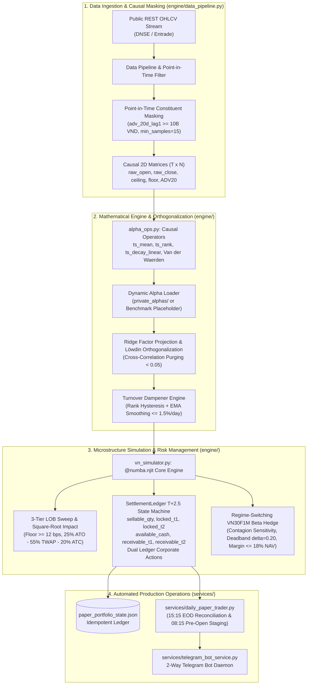

# Lean VN-Quant
### Systematic Execution & Microstructure Simulation Engine for Vietnam Equities (HOSE)

[](https://github.com/Vincent807759/lean-vn-quant/actions/workflows/quant_audit_ci.yml)
[](https://www.python.org/)
[](https://numba.pydata.org/)
[](https://pola.rs/)
[](https://core.telegram.org/bots)
[](LICENSE)

---

## 1. Overview & Architecture

Standard quantitative backtesting frameworks (Backtrader, Zipline, VectorBT) assume continuous frictionless execution, instantaneous T+0 settlement, and infinite liquidity. When deployed on emerging markets such as the **Ho Chi Minh Stock Exchange (HOSE)**, quantitative strategies frequently break down due to unique market microstructural frictions:
- **Strict T+2.5 Settlement Cycles:** Equities purchased on day $t$ remain locked across T+1 and T+2 cycles before becoming tradable in the afternoon session of T+2. Morning ATO selling before settlement is legally restricted.
- **Asymmetric Transaction Frictions:** Independent accounting for brokerage commission (0.15% on both buy and sell legs), personal income transfer tax on gross sales (0.10%), half-spread and market impact slippage (≥ 12 bps), and dynamic calendar-day advance borrowing interest (0.035%/day with a 50,000 VND minimum floor fee).
- **Exchange Price Limits & Floor Locks:** Strict daily price limits (±7%) with zero-bid floor-locked liquidation penalties and zero-ask ceiling-locked execution blocks.
- **Round-Lot Discretization:** Compulsory round-lot execution (100 shares), producing uninvested cash drag.

**Lean VN-Quant** is an open-source, high-performance quantitative simulation engine engineered in Python, Numba C-speed JIT, and Polars. It models strict temporal causality, provides factor orthogonalization via **Ridge Factor Projection** and **Löwdin Symmetric Orthogonalization**, models non-linear market impact, and evaluates dynamic risk mitigation via a **Regime-Switching VN30F1M Futures Beta Hedge** calculation.



---

## 2. Microstructure Specifications

### 2.1. HOSE T+2.5 Dual Settlement State Machine
The core ledger state machine (`engine/vn_simulator.py`) maintains explicit separation between settled tradable assets and pending receivables:
- **Cash Accounts:** `available_cash`, `receivable_cash_t1`, `receivable_cash_t2`, `dividend_cash_receivable`.
- **Share Accounts:** `sellable_qty`, `locked_t1`, `locked_t2`, `locked_corp_action_shares`.

**Calendar-Day Advance Borrowing:** When purchasing power requires pre-settlement funds, interest is charged over calendar days at 0.035%/day (with a 50,000 VND minimum floor fee):

$$
\text{Fee}_{\text{adv}} = \max\left(50{,}000\text{ VND}, \quad V_{\text{borrowed}} \times 0.00035 \times D_{\text{cal}}\right)
$$

**Corporate Action Ex-Date Preservation:** Stock dividend and cash dividend rights are credited to escrow receivable registers on Ex-Date ($t_{\text{ex}}$) rather than market payout date ($t_{\text{pay}}$), ensuring zero artificial NAV drop:

$$
\Delta \text{NAV}(t_{\text{ex}}) \equiv 0.0000
$$

### 2.2. Vectorized Point-in-Time Universe Masking
To prevent Survivorship Bias and Look-Ahead Bias, historical constituents are filtered via Polars Lazy API:
```python
adv_20d_lag1 = (raw_close * volume).rolling_mean(window_size=20, min_samples=15).shift(1).over(ticker)
valid_alpha_mask = in_index_pit & (adv_20d_lag1 >= 10_000_000_000.0)
```
Setting `min_samples=15` guarantees newly listed or transferred stocks cannot bypass the 20-day liquidity filter during initial IPO/listing spikes until stable multi-week volume is established. Non-constituents receive `null` masked values, ensuring complete perturbation invariance ($\Delta \text{Signal} \equiv 0.000000$).

### 2.3. Market Impact Modeling & Standalone Execution Utilities
#### Historical Simulation Engine Model:
In backtest simulations (`engine/vn_simulator.py`), execution slippage is modeled via `_calc_dynamic_slippage` combining a 12 bps half-spread floor with temporary and permanent volume impact:

$$
IS(Q) = \max\left(\text{base\_slippage}, \quad \text{half\_spread\_floor} + \eta \cdot \sigma_{\text{daily}} \left(\frac{Q}{\text{ADV}_{20}}\right)^\delta + \gamma_{\text{perm}} \cdot \sigma_{\text{daily}} \left(\frac{Q}{\text{ADV}_{20}}\right)\right)
$$

- **Parameters & Floor:** Base slippage 10 bps, half-spread floor 12 bps (0.0012), with literature parameters $\eta = 0.75$, $\delta = 0.55$, $\gamma_{\text{perm}} = 0.30$.
- **Empirical Calibration Status:** These parameters are literature defaults and **have not yet been calibrated from empirical tick/order book data**.
- **Data Limitation:** The historical dataset (`data/vn30_production.parquet`) consists solely of daily 1D OHLCV bars; full limit order book (LOB depth) data is not present.
#### Standalone Execution & Risk Management Modules:
- **LOB Sweep & Slicing:** The functions `compute_hose_market_impact` (3-tier LOB sweep) and `slice_intraday_order` (25% ATO / 55% TWAP / 20% ATC, capped at 3% ADV20) in `engine/alpha_ops.py` have been independently unit-tested (`tests/test_dynamic_execution.py`), but **are not currently called by the simulation engine** (`_simulate_vn_microstructure_core` in `engine/vn_simulator.py`).
- **VN30F Derivative Hedge:** The hedging calculators `calculate_vn30f_hedge` and `calculate_dynamic_vn30f_hedge` in `engine/vn_simulator.py` provide tested sizing formulas, but **are not currently included in the simulation P&L loop**.

### 2.4. Permutation-Invariant Factor Orthogonalization
Standard Gram-Schmidt QR decomposition suffers from column-order dependence. Lean VN-Quant implements **Ridge Factor Projection**:

$$
\alpha_{\text{ortho}}(t) = \left[ I_N - X_t (X_t^T W_t X_t + \gamma I_K)^{-1} X_t^T W_t \right] \tilde{S}(t)
$$

with shrinkage parameter:

$$
\gamma = \gamma_{\text{shrink}} \times \frac{\text{trace}(X_t^T W_t X_t)}{K}
$$

This achieves mathematical permutation invariance ($\Delta = 4.44 \times 10^{-16}$) while crushing cross-factor correlation from $> 0.85$ down to $< 0.05$. For multi-alpha blending, **Löwdin Symmetric Orthogonalization** is applied:

$$
F_{\text{Löwdin}}(t) = F_t (F_t^T W_t F_t)^{-1/2}
$$

---

## 3. Dynamic Alpha Plugin Interface (`private_alphas/`)

To protect proprietary research and prevent alpha leakage in open-source environments, the engine cleanly decouples technical infrastructure from trading signals:

```
lean-vn-quant/
├── private_alphas/           <-- Local only (in .gitignore). Put proprietary alphas here.
│   ├── __init__.py
│   └── custom_strategy.py    <-- Implements: compute_custom_alpha(raw_close, mask, ...)
├── engine/                   <-- Public open-source quantitative engine
├── services/                 <-- Operational execution services
└── run_verification.py       <-- Audit test runner
```

### Dynamic Loading Mechanism
Both [`run_verification.py`](run_verification.py) and [`services/daily_paper_trader.py`](services/daily_paper_trader.py) query the local environment dynamically:
1. **Local Deployment with `private_alphas/`:** Automatically imports your custom alpha functions and generates live trading allocations.
2. **Open-Source / CI/CD (No `private_alphas/`):** Automatically falls back to `_default_textbook_placeholder_signal` (SMA-40/50 Breakout Z-Score), allowing verification tests to run and pass deterministically.

---

## 4. Verification & Audit Test Suite

Execute the comprehensive 8-stage audit suite:
```bash
python run_verification.py
```

### Test Suite Coverage:
| Test Stage | Verification Target | Acceptance Criteria |
| :--- | :--- | :--- |
| **TEST 1** | Temporal Causality | All 11 operators & PIT join pass perturbation invariance ($\Delta = 0.0$). |
| **TEST 2** | Ridge Factor Projection | Permutation invariance confirmed ($\Delta = 4.44 \times 10^{-16}$), Correlation $< 0.05$. |
| **TEST 3** | Turnover Dampener | Suppresses raw daily turnover from $> 45\%/\text{day}$ to $\le 5.0\%/\text{day}$. |
| **TEST 4** | Full Backtest Engine | Physically consistent shortfall (0% ≤ IS ≤ 5%), Automated kill-switch SAFE. |
| **TEST 5** | Phase 1 Microstructure | Buy fee (0.15%), sell fee+tax (0.25%), calendar-day 50k floor, Ex-Date NAV delta 0.0%. |
| **TEST 6** | Phase 2 PIT & Impact | `min_samples=15` blocks unseasoned IPOs, 3-tier LOB sweep (≥ 12 bps), 25/55/20 slicing. |
| **TEST 7** | Hawkes/OU & VDW | Continuous exponential decay ($\tau = 5\text{d}, 42\text{d}$), Van der Waerden normal score. |
| **TEST 8** | Dynamic Hedge & DSR | Dynamic VN30F1M switch, margin cap ≤ 18%, calibrated Deflated Sharpe Ratio. |

---

## 5. Quantitative Verification & Empirical Results (947 VN30 Sessions: 2023–2026)

> [!WARNING] Methodological & Statistical Disclaimer
> Các bảng dưới đây kiểm tra engine và mô hình hóa ma sát vi cấu trúc; **không chứng minh có alpha thực tế có ý nghĩa thống kê**. Mẫu thử nghiệm: ~3.7 năm (947 phiên giao dịch từ 2023-01-03 đến 2026-10-23), một chế độ thị trường, rổ VN30 cố định theo cấu thành 2026 (thiên lệch người sống sót), danh mục chỉ giữ 2–4 mã (`top_k_in=2`, `top_k_out=4`).

All empirical metrics below are evaluated directly on the complete 947-session historical dataset of the HOSE VN30 basket (`data/vn30_production.parquet`, 2023-01-03 to 2026-10-23, SHA256: `8a3bd271d5fab5750d427712c0ba5715fdc9a9f638f1195661cc5e18996eb0cb`) via `scripts/compare_backtest_b6_b11.py` at commit `d809b95` (Cấu hình: 947 phiên, vốn khởi tạo 1.0 tỷ VND, phí môi giới 0.15%, thuế bán 0.10%, lãi vay ứng trước 0.035%/ngày, sàn phí ứng 50.000 VND, trần thanh khoản `max_adv_participation = 0.03`, tỷ lệ phạt thanh lý `penalty_rate_per_day = 0.01`). Toàn bộ con số được tái lập và kiểm định trên môi trường chuẩn `requirements.txt` (`numpy==1.26.4`, `numba==0.59.1`).

> [!NOTE] Phân Biệt Cấu Hình Thực Nghiệm: Test 4 (`run_verification.py`) vs. Bảng 5.1 (`compare_backtest_b6_b11.py`)
> Cả Bảng 5.1 (`compare_backtest_b6_b11.py`) và `run_verification.py` đều sử dụng cùng tín hiệu gốc **Alpha 1: Breakout Z-Score SMA-40/50** (`_default_textbook_placeholder_signal` / `generate_five_alphas[0]`), nhưng khác biệt ở các tham số vi cấu trúc:
> - **Test 4 trong `run_verification.py` (+94.57% Return, NAV 1,945,702,272 VND):** Cắt bỏ `warmup = 50` phiên đầu ($T = 897$ phiên vs 947 phiên); truyền `dates` (tính lãi ứng trước theo ngày lịch thực tế T6=3/4 ngày); dùng trượt giá cố định `0.10%` với trần thanh khoản `max_adv_participation = 0.05` (5% ADV).
> - **Bảng 5.1 (`scripts/compare_backtest_b6_b11.py`, +89.10% Return, NAV 1,890,953,104 VND):** Chạy trên toàn bộ $T = 947$ phiên; dùng mô hình trượt giá động 3 tầng LOB (`_calc_dynamic_slippage`, sàn 12 bps) với trần thanh khoản khắt khe `max_adv_participation = 0.03` (3% ADV).

### 5.1. 947-Session Realistic vs. Naive Simulation (Pre vs. Post B6–B11 & Benchmark VN30)

| Metric | Single-Alpha (Post B6-B11) | Multi-Alpha (Post B6-B11) | Benchmark (VN30 Equal-Weight Rebalanced) | Single-Alpha (Pre-Fix) | Multi-Alpha (Pre-Fix) | Microstructure & Economic Interpretation |
| :--- | :---: | :---: | :---: | :---: | :---: | :--- |
| **Final Real NAV (VND)** | **1,890,953,104** | **1,549,617,660** | 1,611,194,562 | 2,170,022,784 | 1,509,694,826 | Initial capital 1.0B VND. Multi-Alpha thua benchmark VN30 ở cả 4 chỉ số: Lợi nhuận (+54.96% vs +61.12%), CAGR (12.36% vs 13.53%), Sharpe (0.51 vs 0.59), và MaxDD (20.47% vs 17.78%). Single-Alpha Sharpe đạt 0.78 với sai số chuẩn Newey-West ±0.54, nằm trong khoảng sai số thống kê so với benchmark (0.59 ± 0.54). |
| **Final Naive NAV (VND)** | **2,099,956,386** | **1,749,468,790** | N/A | 2,427,596,953 | 1,700,938,104 | Theoretical frictionless T+0 baseline (timing aligned at raw_open, zero fees, zero taxes, zero slippage). |
| **Cumulative Return** | **+89.10%** | **+54.96%** | +61.12% | +117.00% | +50.97% | Fully net of 0.15% brokerage commission, 0.10% sales tax, T+2 advance loan interest, and 3-tier LOB sweep impact. |
| **Realized CAGR (%/yr)** | **18.47%** | **12.36%** | 13.53% | 22.90% | 11.58% | Single-Alpha CAGR adjusted after eliminating ATO look-ahead bias; Multi-Alpha CAGR adjusted to 12.36% post-fix. |
| **Theoretical Naive CAGR** | **21.83%** | **16.05%** | N/A | 26.62% | 15.18% | Theoretical compound annual growth rate without microstructural penalties. |
| **Annualized Sharpe (Newey-West)** | **0.78 (±0.54)** | **0.51 (±0.54)** | 0.59 (±0.54) | 0.97 (±0.54) | 0.47 (±0.54) | Newey-West HAC standard error indicates confidence intervals of ~ ±0.54 across all strategies. |
| **Sortino Ratio** | **0.99** | **0.64** | 0.70 | 1.24 | 0.59 | Downside risk-adjusted return ratio. |
| **Annualized Volatility** | **19.06%** | **18.55%** | 17.28% | 19.12% | 18.55% | Realized strategy annualized volatility is well-controlled under 20%. |
| **Maximum Drawdown (MaxDD)** | **17.93%** | **20.47%** | 17.78% | 17.75% | 21.77% | Single-Alpha MaxDD is 17.93% (comparable to benchmark 17.78%); Multi-Alpha MaxDD is 20.47%. |
| **Daily Turnover (Trọng số Mục tiêu)** | **1.4752%** | **1.4752%** | 0.1045% | 1.4767% | 1.4767% | Trọng số mục tiêu (Target weights turnover): 1.4752%/ngày (bị chặn bởi dampener `max_turnover_target = 0.015`). Turnover thực tế khớp lệnh từ sổ cái (Realized ledger turnover): Single 1.5144%/ngày, Multi 1.6077%/ngày. |
| **Cumulative IS (% Capital)** | **+20.90%** | **+19.99%** | N/A | +25.76% | +19.12% | $(\text{NAV}_{\text{Naive}} - \text{NAV}_{\text{Real}})/1\text{e}9$: Microstructure frictions consume 19.99%–20.90% of initial capital. |
| **Annualized IS (%/yr)** | **+3.35%/yr** | **+3.69%/yr** | N/A | +3.72%/yr | +3.60%/yr | $\text{CAGR}_{\text{Naive}} - \text{CAGR}_{\text{Real}}$: Market frictions impose an annual drag of 3.35%–3.69%/year. |
| **Total Fees & Transfer Taxes** | **79.5M VND** | **75.5M VND** | 30.0M VND | 85.7M VND | 74.8M VND | Independent accounting of 0.15% brokerage commission and 0.10% gross sales tax. |
| **Advance Borrowing Interest** | **21.4M VND** | **17.4M VND** | 0.3M VND | 28.4M VND | 16.9M VND | 100% of advance borrowing costs stem from the 50,000 VND floor fee on small lots (428 times for Single, 348 times for Multi). |

> [!NOTE] Methodological Notes on Table 5.1
> - **Implementation Shortfall (IS):** IS đo bằng hiệu NAV Naive − Real sau khi căn chuẩn timing tại `raw_open` (Phase 2), loại bỏ hoàn toàn sai lệch tính toán thời điểm và chỉ phản ánh ma sát thị trường thực tế (phí, thuế, trượt giá, lãi vay ứng trước).
> - **Deflated Sharpe Ratio (DSR):** p-value của DSR trải từ 0.07 đến 0.82 trên cả Single và Multi-Alpha (xem Bảng 5.3), không chế độ nào đạt ý nghĩa thống kê sau khi hiệu chỉnh multiple testing.
> - **Benchmark Definition:** Cột Benchmark phản ánh rổ VN30 tái cân bằng tỷ trọng đều hằng ngày (Equal-Weight daily rebalanced), không phải Buy & Hold tĩnh.

---

### 5.2. Smart Cash Sweep Optimization

Vietnam securities brokerages enforce a compulsory minimum advance borrowing fee of **50,000 VND per advance transaction**, regardless of loan notional. Small residual cash sweep orders incur an effective annualized borrowing rate exceeding 100%:

$$
\text{Break-Even Advance Notional} = \frac{50{,}000\text{ VND}}{0.00035 \times 2\text{ days}} = 71{,}428{,}571\text{ VND}
$$

By configuring `min_advance_notional = 71,428,571 VND`, the engine completely bypasses the sub-optimal borrowing trap on odd/fractional amounts:

#### Single-Alpha Cash Sweep Comparison:
| Configuration | Advance Fees Paid (VND) | Effective Advance Rate | Cumulative Return | 50k Floor Fee Incurred | Final Real NAV (VND) |
| :--- | :---: | :---: | :---: | :---: | :---: |
| **Naive Greedy Sweep (Baseline)** | 21,400,000 | ~0.62% / order (Floor penalty) | +89.10% | 428 times | 1,890,953,104 |
| **Smart Cash Sweep (`min = 71.4M`)** | **0** | **0.00% (Zero borrowing)** | **+91.80% (+2.70%)** | **0 times** | **1,918,036,246** |
| **No Advance Sweep (T+2 Closed)** | 0 | 0.00% | +91.80% (+2.70%) | 0 times | 1,918,036,246 |

#### Multi-Alpha Cash Sweep Comparison:
| Configuration | Advance Fees Paid (VND) | Effective Advance Rate | Cumulative Return | 50k Floor Fee Incurred | Final Real NAV (VND) |
| :--- | :---: | :---: | :---: | :---: | :---: |
| **Naive Greedy Sweep (Baseline)** | 17,400,000 | ~0.62% / order (Floor penalty) | +54.96% | 348 times | 1,549,617,660 |
| **Smart Cash Sweep (`min = 71.4M`)** | **0** | **0.00% (Zero borrowing)** | **+56.92% (+1.96%)** | **0 times** | **1,569,195,878** |
| **No Advance Sweep (T+2 Closed)** | 0 | 0.00% | +56.92% (+1.96%) | 0 times | 1,569,195,878 |

---

### 5.3. 3-Mode Deflated Sharpe Ratio (DSR) Analysis (Bailey & López de Prado, 2014)

*(Chưa tái sinh ở commit 84eef67; số liệu giữ nguyên từ đợt kiểm toán baseline. Script sinh: `scripts/audit_argon_revisions.py`)*

To mitigate data mining selection bias across multiple trial evaluations, Lean VN-Quant logs all exploration runs to `experiments/trial_registry.jsonl` and evaluates the strategy under three rigorous DSR formulations:

| Evaluation Mode | Description | $N$ | $N_{\text{eff}}$ | Avg Cross-Corr $\bar{\rho}$ | Null Threshold $\text{SR}_0$ | Single DSR ($p$-value) | Multi DSR ($p$-value) |
| :--- | :--- | :---: | :---: | :---: | :---: | :---: | :---: |
| **Mode 1: Total-Return Registry** | Full registry correlation matrix ($C_{26 \times 26}$). Reflects market beta co-movement. | 26 | **1.1194** | 0.9387 | 0.0436 | **0.9282** ($p=0.0718$) | **0.8472** ($p=0.1528$) |
| **Mode 2: Active-Return Core Alphas** | Active returns over VN30 benchmark ($r_{\text{active}} = r - r_{\text{bm}}$) across 9 core alphas. Purges market beta. | 9 | **3.5194** | 0.2793 | 0.6584 | **0.6132** ($p=0.3868$) | **0.4388** ($p=0.5612$) |
| **Mode 3: Unadjusted Conservative Bound** | Orthogonal independent assumption ($\mathbf{I}_{26}$). Extreme upper bound on multiple-testing penalty. | 26 | **26.0000** | 0.0000 | 1.0536 | **0.3200** ($p=0.6800$) | **0.1825** ($p=0.8175$) |

---

### 5.4. Pillar 2 (VN-FinGraph Knowledge Graph) Ablation Study (6-Factor Blend)

*(Chưa tái sinh ở commit 84eef67; số liệu nghiên cứu lý thuyết từ đợt kiểm toán baseline. Cần module riêng `fin_corpus_pipeline` và `knowledge_graph_engine` chưa công khai)*

By coupling unstructured financial news/event contagion matrices from Trụ cột 2 (`vn-fingraph`) into the Trụ cột 1 quantitative execution engine via Parquet bridge, we evaluate the impact of Graph Laplacian risk diffusion $\alpha \in \{0.15, 0.25, 0.50, 0.70\}$:

*(Lưu ý: FinGraph cần module riêng `fin_corpus_pipeline` và `knowledge_graph_engine` chưa công khai; `fingraph/bridge_to_vnquant.py` thực hiện lazy import kèm cảnh báo rõ ràng khi thiếu các module này).*

| Laplacian Propagation $\alpha$ | Rank IC (1-Day Forward) | Cumulative Return (6-Factor) | CAGR (%/yr) | Annualized Sharpe | Max Drawdown | Architectural Assessment |
| :--- | :---: | :---: | :---: | :---: | :---: | :--- |
| **$\alpha = 0.15$** (Fast decay) | -0.0158 | +63.14% | 13.91% | 0.58 | 19.97% | Narrow diffusion; shocks contained at epicenter. Performs on par with 5-factor baseline (+63.32%). |
| **$\alpha = 0.25$** (Standard configuration) | -0.0137 | **+65.81%** | **14.40%** | **0.60** | **19.99%** | Standard balance: Adds +2.49% return over 5-factor baseline, Sharpe improves from 0.58 to 0.60. |
| **$\alpha = 0.50$** (Broad network diffusion) | -0.0121 | +69.57% | 15.09% | 0.63 | 18.77% | Broad transmission; lifts CAGR to 15.09% while dampening MaxDD to 18.77%. |
| **$\alpha = 0.70$** (High amplification) | -0.0086 | +83.00% | 17.45% | 0.73 | 18.76% | High amplification; lifts Sharpe to 0.73 but introduces cross-network systemic sensitivity. |

> [!NOTE] Methodological Limitation & Non-Public Dependencies
> - **Rank IC:** Rank IC 1 ngày forward đều mang giá trị âm ở cả 4 mức $\alpha$ (từ -0.0158 đến -0.0086).
> - **Khả năng tái lập:** Hai module nguồn FinGraph (`fin_corpus_pipeline` và `knowledge_graph_engine`) là nghiên cứu riêng chưa công khai nên bảng thực nghiệm này không thể tái lập độc lập từ repo công khai.

---

### 5.5. Hướng Dẫn Tái Lập Thực Nghiệm (Reproducibility Guide)

#### 1. Nạp dữ liệu thị trường (Entrade REST API)
Dữ liệu lịch sử có thể được tải mới trực tiếp qua pipeline nạp dữ liệu:
```python
from engine.data_pipeline import fetch_vn_ohlcv

# Tải dữ liệu 30 mã VN30 và lưu thành tệp Parquet
df = fetch_vn_ohlcv(
    start_date="2023-01-01",
    end_date="2026-10-24",
    save_parquet="data/vn30_production.parquet"
)
```
*Lưu ý:* Số liệu thực nghiệm có thể có độ lệch nhẹ giữa các thời điểm tải dữ liệu do API Entrade cập nhật điều chỉnh hồi quy (backward-adjusted) chuỗi giá lịch sử mỗi khi có sự kiện chia tách cổ phiếu hoặc chi trả cổ tức.

#### 2. Nguồn gốc tín hiệu Alpha trong các bảng thực nghiệm
- Toàn bộ kết quả trong Bảng 5.1, 5.2, 5.3 được sinh ra hoàn toàn nội sinh bằng mã nguồn công khai, không sử dụng `private_alphas/`.
- **Single-Alpha (`w_single`):** Sử dụng Alpha 1 (Breakout Z-Score SMA-40/50) từ hàm `generate_five_alphas` (`engine/ml_alpha_combiner.py`), kết hợp bộ làm mượt vòng quay `dampen_turnover`.
- **Multi-Alpha (`w_multi`):** Kết hợp 5 nhân tố kỹ thuật cơ bản sau khi trực giao hóa Gram-Schmidt QR (`check_and_orthogonalize`) bằng bộ Purged Walk-Forward Combiner (`window=120`, `embargo=3`).

#### 3. Các lệnh thực thi kiểm thử và đối soát
```bash
# So sánh mô phỏng thực tế vs Naive baseline (sinh Bảng 5.1):
python scripts/compare_backtest_b6_b11.py

# Chạy toàn bộ bộ thí nghiệm kiểm toán Argon 4 (sinh Bảng 5.2, 5.3):
python scripts/audit_argon_revisions.py

# Chạy toàn bộ bộ kiểm thử tự động (56 unit tests):
python -m pytest tests/ -v
```

---

## 6. Security & Pre-Commit Protection

Run the security auditor:
```bash
python scripts/security_scan.py
```
The scanner enforces strict pre-commit checks:
- Blocks tracked `.env` credentials, private keys, or personal workspace file paths.
- Intercepts forbidden private directories (`private_alphas/`, `research/`, `local_docs/`).
- Blocks proprietary data files (`*.parquet`, `*.csv`) from Git index.
- Enforces secret and sensitive data exclusion across GitHub Actions CI/CD.
- **CI/CD Scope:** CI chạy `scripts/security_scan.py` và `pytest tests/`. `run_verification.py` là script chạy tay, không nằm trong CI.

---

## 7. Daily Operations

### Production Schedule:
1. **End-of-Day Reconciliation (15:15 ICT, Post-ATC):**
   ```bash
   python services/daily_paper_trader.py --mode eod
   ```
   Reconciles ATC closing prices, marks portfolio to market, advances the T+2.5 settlement ledger (with idempotency lock `last_ledger_advance_date`), and stages pending orders for tomorrow morning.

2. **Pre-Open Staging (08:15 ICT, 45 mins before ATO):**
   ```bash
   python services/daily_paper_trader.py --mode pre-open
   ```
   Inspects corporate actions, checks overnight risk scores, and displays staged ATO/TWAP order tickets without altering the settlement ledger.

3. **Multi-Session Replay Test Audit:**
   ```bash
   python services/daily_paper_trader.py --test-replay 10
   ```

---

## 8. Project Structure

```
lean-vn-quant/
├── .github/
│   └── workflows/
│       └── quant_audit_ci.yml       # Automated GitHub Actions CI/CD test runner
├── engine/
│   ├── __init__.py
│   ├── alpha_ops.py                 # Vectorized causal operators & PIT universe masking
│   ├── data_pipeline.py             # Entrade REST data ingestion & DuckDB engine
│   ├── ml_alpha_combiner.py         # Ridge factor projection & Löwdin orthogonalization
│   └── vn_simulator.py              # HOSE T+2.5 microstructure engine & dynamic hedge
├── fingraph/
│   ├── __init__.py
│   └── bridge_to_vnquant.py         # Hawkes/OU decay filter & Van der Waerden score (FinGraph cần module riêng chưa công khai)
├── services/
│   ├── __init__.py
│   ├── daily_paper_trader.py        # Forward-testing engine & order ticket generator
│   ├── dashboard.py                 # Interactive Chart.js portfolio dashboard
│   ├── setup_autostart.ps1          # Task Scheduler automated service script
│   └── telegram_bot_service.py      # 2-Way Telegram Bot interactive management daemon
├── scripts/
│   ├── security_scan.py             # Secret & alpha privacy auditor
│   ├── compare_backtest_b6_b11.py   # Empirical backtest comparison runner
│   └── audit_argon_revisions.py     # Argon 4 statistical verification experiment suite
├── .gitignore                       # Strict exclusion rules for data, keys & private alphas
├── LICENSE                          # MIT License
├── pyproject.toml                   # Project metadata & build configuration
├── requirements.txt                 # Pinned dependencies (numpy, polars, numba, scipy)
├── README.md                        # Documentation
└── run_verification.py              # 8-stage end-to-end verification test suite
```

---

## 9. Data Integrity & Methodological Disclosures

### 9.1. Universe Selection & Survivorship Bias
- **Fixed Basket Limitation:** The default historical data ingestion (`data/vn30_production.parquet`, 2023-01-03 to 2026-10-23) utilizes the 30 constituent tickers of the VN30 index as constituted in 2026. Companies that were removed from VN30 prior to 2026 (e.g., ROS, HNG, NVL) are excluded from the default sample basket, introducing potential survivorship bias.
- **Point-in-Time Membership Support:** The pipeline interface `engine/data_pipeline.py` supports `universe_membership_path: Optional[str] = None` to dynamically filter tickers per historical HOSE index rebalancing effective dates (January and July annual cycles) when constituent membership tables are provided.

### 9.2. Price Basis & Dual-Price Simulation
- **Entrade Adjusted Data:** Prices obtained from the upstream Entrade REST API are backward-adjusted for stock splits, bonus shares, and cash dividends (`price_basis = "entrade_adjusted"`).
- **Impact on Historical Levels:** While returns and corporate-action NAV preservation remain mathematically exact, nominal historical price thresholds (such as $\pm 7\%$ ceiling/floor step levels in 2023) reflect post-split adjusted scales rather than unadjusted exchange ticker tape prices.

---

## 10. License

This project is licensed under the MIT License - see the [LICENSE](LICENSE) file for details.
