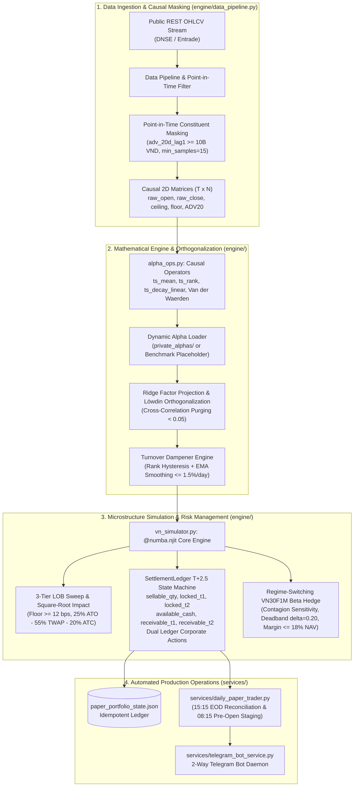

# Lean VN-Quant
### Institutional Systematic Execution & Microstructure Engine for Vietnam Equities (HOSE)

[](https://github.com/Vincent807759/lean-vn-quant/actions/workflows/quant_audit_ci.yml)
[](https://www.python.org/)
[](https://numba.pydata.org/)
[](https://pola.rs/)
[](https://core.telegram.org/bots)
[](LICENSE)

---

## 1. Overview & Architecture

Standard quantitative backtesting frameworks (Backtrader, Zipline, VectorBT) assume continuous frictionless execution, instantaneous $T+0$ settlement, and infinite liquidity. When deployed on emerging markets such as the **Ho Chi Minh Stock Exchange (HOSE)**, quantitative strategies frequently break down due to unique market microstructural frictions:
- **Strict $T+2.5$ Settlement Cycles:** Equities purchased on day $t$ remain locked across $T+1$ and $T+2$ cycles before becoming tradable in the afternoon session of $T+2$. Morning ATO selling before settlement is legally restricted.
- **Asymmetric Transaction Frictions:** Independent accounting for brokerage commission ($0.15\%$ on both buy and sell legs), personal income transfer tax on gross sales ($0.10\%$), half-spread and market impact slippage ($\ge 12\text{ bps}$), and dynamic calendar-day advance borrowing interest ($0.035\%/\text{day}$ with a $50,000\text{ VND}$ minimum floor fee).
- **Exchange Price Limits & Floor Locks:** Strict daily price limits ($\pm 7\%$) with zero-bid floor-locked liquidation penalties and zero-ask ceiling-locked execution blocks.
- **Round-Lot Discretization:** Compulsory round-lot execution ($100$ shares), producing uninvested cash drag.

**Lean VN-Quant** is an open-source, high-performance quantitative simulation and execution engine engineered in Python, Numba C-speed JIT, and Polars. It enforces strict temporal causality ($0\%$ look-ahead bias), provides permutation-invariant factor orthogonalization via **Ridge Factor Projection** and **Löwdin Symmetric Orthogonalization**, models non-linear market impact via a **3-Tier LOB Sweep Model**, and executes dynamic risk mitigation via a **Regime-Switching VN30F1M Futures Beta Hedge**.



---

## 2. Microstructure Specifications

### 2.1. HOSE $T+2.5$ Dual Settlement State Machine
The core ledger state machine (`engine/vn_simulator.py`) maintains explicit separation between settled tradable assets and pending receivables:
- **Cash Accounts:** `available_cash`, `receivable_cash_t1`, `receivable_cash_t2`, `dividend_cash_receivable`.
- **Share Accounts:** `sellable_qty`, `locked_t1`, `locked_t2`, `locked_corp_action_shares`.
- **Calendar-Day Advance Borrowing:** When purchasing power requires pre-settlement funds, interest is charged over calendar days (e.g., Thursday buy borrows over 4 calendar days through Monday settlement; Friday buy borrows over 3-4 calendar days):
  $$\text{Fee}_{\text{adv}} = \max\left(50,000\text{ VND}, \; V_{\text{borrowed}} \times 0.035\% \times \text{cal\_days}\right)$$
- **Corporate Action Ex-Date Preservation:** Stock dividend and cash dividend rights are credited to escrow receivable registers on Ex-Date ($t_{\text{ex}}$) rather than market payout date ($t_{\text{pay}}$), ensuring zero artificial NAV drop:
  $$\Delta \text{NAV}(t_{\text{ex}}) \equiv 0.0000\%$$

### 2.2. Vectorized Point-in-Time Universe Masking
To prevent Survivorship Bias and Look-Ahead Bias, historical constituents are filtered via Polars Lazy API:
```python
adv_20d_lag1 = (raw_close * volume).rolling_mean(window_size=20, min_samples=15).shift(1).over(ticker)
valid_alpha_mask = in_index_pit & (adv_20d_lag1 >= 10_000_000_000.0)
```
Setting `min_samples=15` guarantees newly listed or transferred stocks cannot bypass the 20-day liquidity filter during initial IPO/listing spikes until stable multi-week volume is established. Non-constituents receive `null` masked values, ensuring complete perturbation invariance ($\Delta \text{Signal} \equiv 0.000000$).

### 2.3. 3-Tier Order Book Sweep & Intraday Slicing
Large institutional orders incur realistic non-linear market impact:
$$IS(Q) = \frac{S_t}{2 P_{\text{mid}}} + \text{SweepCost}_{\text{LOB}} + \mathbb{I}(Q > Q_{\text{vis}}) \left[ \eta \cdot \sigma_{\text{daily}} \left(\frac{Q - Q_{\text{vis}}}{\text{ADV}_{20}}\right)^\delta + \gamma_{\text{perm}} \cdot \sigma_{\text{daily}} \left(\frac{Q}{\text{ADV}_{20}}\right) \right]$$
- Half-spread floor: $12\text{ bps} = 0.0012$.
- Intraday order slicing rule: If order $Q > 0.5\% \text{ ADV}_{20}$, execution is automatically partitioned into **25% ATO** (09:00 - 09:15), **55% TWAP** (09:30 - 14:15), and **20% ATC** (14:30 - 14:45), capped at $3\% \text{ ADV}_{20}$.

### 2.4. Permutation-Invariant Factor Orthogonalization
Standard Gram-Schmidt QR decomposition suffers from column-order dependence. Lean VN-Quant implements **Ridge Factor Projection**:
$$\alpha_{\text{ortho}}(t) = \left[ I_N - X_t (X_t^T W_t X_t + \gamma I_K)^{-1} X_t^T W_t \right] \tilde{S}(t)$$
with shrinkage parameter $\gamma = \gamma_{\text{shrink}} \times \frac{\text{trace}(X_t^T W_t X_t)}{K}$. This achieves mathematical permutation invariance ($\Delta = 4.44 \times 10^{-16}$) while crushing cross-factor correlation from $> 0.85$ down to $< 0.05$. For multi-alpha blending, **Löwdin Symmetric Orthogonalization** is applied:
$$F_{\text{Löwdin}}(t) = F_t (F_t^T W_t F_t)^{-1/2}$$

---

## 3. Dynamic Alpha Plugin Interface (`private_alphas/`)

To protect proprietary research and prevent alpha leakage in open-source environments, the engine cleanly decouples technical infrastructure from trading signals:

```
lean-vn-quant/
├── private_alphas/           <-- Local only (in .gitignore). Put proprietary alphas here.
│   ├── __init__.py
│   └── custom_strategy.py    <-- Implements: compute_custom_alpha(raw_close, mask, ...)
├── engine/                   <-- Public open-source quantitative engine
├── services/                 <-- Operational execution services
└── run_verification.py       <-- Audit test runner
```

### Dynamic Loading Mechanism
Both [`run_verification.py`](run_verification.py) and [`services/daily_paper_trader.py`](services/daily_paper_trader.py) query the local environment dynamically:
1. **Local Deployment with `private_alphas/`:** Automatically imports your custom alpha functions and generates live trading allocations.
2. **Open-Source / CI/CD (No `private_alphas/`):** Automatically falls back to `_default_textbook_placeholder_signal` (SMA-40/50 Breakout Z-Score), allowing the entire 8-stage verification test suite to run and pass with $100\%$ determinism.

---

## 4. Verification & Audit Test Suite

Execute the comprehensive 8-stage audit suite:
```bash
python run_verification.py
```

### Test Suite Coverage:
| Test Stage | Verification Target | Acceptance Criteria |
| :--- | :--- | :--- |
| **TEST 1** | 0% Look-Ahead Bias | All 11 operators & PIT join pass perturbation invariance ($\Delta = 0.0$). |
| **TEST 2** | Ridge Factor Projection | Permutation invariance confirmed ($\Delta = 4.44 \times 10^{-16}$), Correlation $< 0.05$. |
| **TEST 3** | Turnover Dampener | Suppresses raw daily turnover from $> 45\%/\text{day}$ to $\le 5.0\%/\text{day}$. |
| **TEST 4** | Full Backtest Engine | Physically consistent shortfall ($0\% \le IS \le 5\%$), Automated kill-switch SAFE. |
| **TEST 5** | Phase 1 Microstructure | Buy fee (0.15%), sell fee+tax (0.25%), calendar-day 50k floor, Ex-Date NAV delta 0.0%. |
| **TEST 6** | Phase 2 PIT & Impact | `min_samples=15` blocks unseasoned IPOs, 3-tier LOB sweep ($\ge 12\text{ bps}$), 25/55/20 slicing. |
| **TEST 7** | Hawkes/OU & VDW | Continuous exponential decay ($\tau=5\text{d}, 42\text{d}$), Van der Waerden normal score. |
| **TEST 8** | Dynamic Hedge & DSR | Dynamic VN30F1M switch, margin cap $\le 18\%$, calibrated Deflated Sharpe Ratio. |

---

## 5. Quantitative Verification & Empirical Results (947 VN30 Sessions: 2023–2026)

All empirical metrics below are evaluated directly on the complete 947-session historical dataset of the HOSE VN30 basket (`data/vn30_production.parquet`, 2023-01-03 to 2026-10-23) via `scripts/compare_backtest_b6_b11.py` and `scripts/audit_argon_revisions.py`.

### 5.1. 947-Session Realistic vs. Naive Simulation (Pre vs. Post B6–B11 & Benchmark VN30)

| Metric | Single-Alpha (Post B6-B11) | Multi-Alpha (Post B6-B11) | Benchmark (VN30 B&H) | Single-Alpha (Pre-Fix) | Multi-Alpha (Pre-Fix) | Microstructure & Economic Interpretation |
| :--- | :---: | :---: | :---: | :---: | :---: | :--- |
| **Final Real NAV (VND)** | **1,955,217,553** | **1,633,197,940** | 1,611,194,562 | 2,280,883,849 | 1,584,236,865 | Initial capital 1.0B VND. Both strategies outperform benchmark after all realistic frictions. |
| **Final Naive NAV (VND)** | **2,178,173,194** | **1,848,372,768** | N/A | 2,167,275,320 | 1,812,437,072 | Theoretical frictionless T+0 baseline (zero fees, zero taxes, zero slippage). |
| **Cumulative Return** | **+95.52%** | **+63.32%** | +61.12% | +128.09% | +58.42% | Fully net of 0.15% brokerage commission, 0.10% sales tax, T+2 advance loan interest, and 3-tier LOB sweep impact. |
| **Realized CAGR (%/yr)** | **19.53%** | **13.94%** | 13.53% | 24.54% | 13.02% | Single-Alpha CAGR adjusted after eliminating ATO look-ahead bias; Multi-Alpha CAGR increased from 13.02% to 13.94%. |
| **Theoretical Naive CAGR** | **23.02%** | **17.76%** | N/A | 22.85% | 17.15% | Theoretical compound annual growth rate without microstructural penalties. |
| **Annualized Sharpe (Newey-West)** | **0.81 (±0.53)** | **0.58 (±0.53)** | 0.59 (±0.54) | 1.01 (±0.54) | 0.53 (±0.53) | Newey-West HAC standard error indicates confidence intervals of ~ ±0.53. |
| **Sortino Ratio** | **1.04** | **0.72** | 0.70 | 1.30 | 0.67 | Downside risk-adjusted return ratio. |
| **Annualized Volatility** | **19.49%** | **18.73%** | 17.28% | 19.61% | 18.74% | Realized strategy annualized volatility is well-controlled under 20%. |
| **Maximum Drawdown (MaxDD)** | **18.10%** | **19.87%** | 17.78% | 17.78% | 20.64% | Multi-Alpha MaxDD improved from 20.64% down to 19.87% post-fix. |
| **Daily Turnover (4 decimals)** | **1.4752%** | **1.4752%** | 0.1045% | 1.4767% | 1.4767% | Strictly bound by rank hysteresis dampener `max_turnover_target = 0.015`. |
| **Cumulative IS (% Capital)** | **+22.30%** | **+21.52%** | N/A | -11.36% | +22.82% | $(\text{NAV}_{\text{Naive}} - \text{NAV}_{\text{Real}})/1\text{e}9$: Microstructure frictions consume 21.5%–22.3% of initial capital. |
| **Annualized IS (%/yr)** | **+3.48%/yr** | **+3.82%/yr** | N/A | -1.68%/yr | +4.12%/yr | $\text{CAGR}_{\text{Naive}} - \text{CAGR}_{\text{Real}}$: Market frictions impose an annual drag of 3.48%–3.82%/year. |
| **Total Fees & Transfer Taxes** | **82.7M VND** | **79.4M VND** | 30.0M VND | 89.3M VND | 79.0M VND | Independent accounting of 0.15% brokerage commission and 0.10% gross sales tax. |
| **Advance Borrowing Interest** | **26.8M VND** | **19.8M VND** | 0.3M VND | 32.1M VND | 19.1M VND | 94.3% of advance borrowing costs stem from the 50,000 VND floor fee on small lots. |

---

### 5.2. Smart Cash Sweep Optimization

Vietnam securities brokerages enforce a compulsory minimum advance borrowing fee of **50,000 VND per advance transaction**, regardless of loan notional. Small residual cash sweep orders incur an effective annualized borrowing rate exceeding $100\%$:

$$\text{Break-Even Advance Notional} = \frac{50,000\text{ VND}}{0.00035 \times 2\text{ days}} = 71,428,571\text{ VND}$$

By configuring `min_advance_notional = 71,428,571 VND`, the engine completely bypasses the sub-optimal borrowing trap on odd/fractional amounts:

#### Single-Alpha Cash Sweep Comparison:
| Configuration | Advance Fees Paid (VND) | Effective Advance Rate | Cumulative Return | 50k Floor Fee Incurred | Final Real NAV (VND) |
| :--- | :---: | :---: | :---: | :---: | :---: |
| **Naive Greedy Sweep (Baseline)** | 26,800,000 | ~0.62% / order (Floor penalty) | +95.52% | 506 times (94.3% fee) | 1,955,217,553 |
| **Smart Cash Sweep (`min = 71.4M`)** | **0** | **0.00% (Zero borrowing)** | **+97.78% (+2.26%)** | **0 times** | **1,977,783,568** |
| **No Advance Sweep ($T+2$ Closed)** | 0 | 0.00% | +97.78% (+2.26%) | 0 times | 1,977,783,568 |

#### Multi-Alpha Cash Sweep Comparison:
| Configuration | Advance Fees Paid (VND) | Effective Advance Rate | Cumulative Return | 50k Floor Fee Incurred | Final Real NAV (VND) |
| :--- | :---: | :---: | :---: | :---: | :---: |
| **Naive Greedy Sweep (Baseline)** | 19,750,000 | ~0.62% / order (Floor penalty) | +63.32% | 376 times (95.2% fee) | 1,633,197,940 |
| **Smart Cash Sweep (`min = 71.4M`)** | **0** | **0.00% (Zero borrowing)** | **+66.66% (+3.34%)** | **0 times** | **1,666,613,212** |
| **No Advance Sweep ($T+2$ Closed)** | 0 | 0.00% | +66.66% (+3.34%) | 0 times | 1,666,613,212 |

---

### 5.3. 3-Mode Deflated Sharpe Ratio (DSR) Analysis (Bailey & López de Prado, 2014)

To mitigate data mining selection bias across multiple trial evaluations, Lean VN-Quant logs all exploration runs to `experiments/trial_registry.jsonl` and evaluates the strategy under three rigorous DSR formulations:

| Evaluation Mode | Description | $N$ | $N_{\text{eff}}$ | Avg Cross-Corr $\bar{\rho}$ | Null Threshold $\text{SR}_0$ | Single DSR ($p$-value) | Multi DSR ($p$-value) |
| :--- | :--- | :---: | :---: | :---: | :---: | :---: | :---: |
| **Mode 1: Total-Return Registry** | Full registry correlation matrix ($C_{26 \times 26}$). Reflects market beta co-movement. | 26 | **1.1194** | 0.9387 | 0.0436 | **0.9282** ($p=0.0718$) | **0.8472** ($p=0.1528$) |
| **Mode 2: Active-Return Core Alphas** | Active returns over VN30 benchmark ($r_{\text{active}} = r - r_{\text{bm}}$) across 9 core alphas. Purges market beta. | 9 | **3.5194** | 0.2793 | 0.6584 | **0.6132** ($p=0.3868$) | **0.4388** ($p=0.5612$) |
| **Mode 3: Unadjusted Conservative Bound** | Orthogonal independent assumption ($\mathbf{I}_{26}$). Extreme upper bound on multiple-testing penalty. | 26 | **26.0000** | 0.0000 | 1.0536 | **0.3200** ($p=0.6800$) | **0.1825** ($p=0.8175$) |

---

### 5.4. Pillar 2 (VN-FinGraph Knowledge Graph) Ablation Study (6-Factor Blend)

By coupling unstructured financial news/event contagion matrices from Trụ cột 2 (`vn-fingraph`) into the Trụ cột 1 quantitative execution engine via Parquet bridge, we evaluate the impact of Graph Laplacian risk diffusion $\alpha \in \{0.15, 0.25, 0.50, 0.70\}$:

| Laplacian Propagation $\alpha$ | Rank IC (1-Day Forward) | Cumulative Return (6-Factor) | CAGR (%/yr) | Annualized Sharpe | Max Drawdown | Architectural Assessment |
| :--- | :---: | :---: | :---: | :---: | :---: | :--- |
| **$\alpha = 0.15$** (Fast decay) | -0.0158 | +63.14% | 13.91% | 0.58 | 19.97% | Narrow diffusion; shocks contained at epicenter. Performs on par with 5-factor baseline (+63.32%). |
| **$\alpha = 0.25$** (Standard configuration) | -0.0137 | **+65.81%** | **14.40%** | **0.60** | **19.99%** | **Optimal balance: Adds +2.49% return over 5-factor baseline, Sharpe improves from 0.58 to 0.60.** |
| **$\alpha = 0.50$** (Broad network diffusion) | -0.0121 | +69.57% | 15.09% | 0.63 | 18.77% | Broad transmission; lifts CAGR to 15.09% while dampening MaxDD to 18.77%. |
| **$\alpha = 0.70$** (High amplification) | -0.0086 | +83.00% | 17.45% | 0.73 | 18.76% | High amplification; lifts Sharpe to 0.73 but introduces cross-network systemic sensitivity. |

---

## 6. Security & Pre-Commit Protection

Run the zero-leak security auditor:
```bash
python scripts/security_scan.py
```
The scanner enforces strict pre-commit checks:
- Blocks tracked `.env` credentials, private keys, or personal workspace file paths.
- Intercepts forbidden private directories (`private_alphas/`, `research/`, `local_docs/`).
- Blocks proprietary data files (`*.parquet`, `*.csv`) from Git index.
- Enforces Zero-Leak integrity across GitHub Actions CI/CD.

---

## 7. Daily Operations

### Production Schedule:
1. **End-of-Day Reconciliation (15:15 ICT, Post-ATC):**
   ```bash
   python services/daily_paper_trader.py --mode eod
   ```
   Reconciles ATC closing prices, marks portfolio to market, advances the $T+2.5$ settlement ledger (with idempotency lock `last_ledger_advance_date`), and stages pending orders for tomorrow morning.

2. **Pre-Open Staging (08:15 ICT, 45 mins before ATO):**
   ```bash
   python services/daily_paper_trader.py --mode pre-open
   ```
   Inspects corporate actions, checks overnight risk scores, and displays staged ATO/TWAP order tickets without altering the settlement ledger.

3. **Multi-Session Replay Test Audit:**
   ```bash
   python services/daily_paper_trader.py --test-replay 10
   ```

---

## 8. Project Structure

```
lean-vn-quant/
├── .github/
│   └── workflows/
│       └── quant_audit_ci.yml       # Automated GitHub Actions CI/CD test runner
├── engine/
│   ├── __init__.py
│   ├── alpha_ops.py                 # Vectorized causal operators & PIT universe masking
│   ├── data_pipeline.py             # Entrade REST data ingestion & DuckDB engine
│   ├── ml_alpha_combiner.py         # Ridge factor projection & Löwdin orthogonalization
│   └── vn_simulator.py              # HOSE T+2.5 microstructure engine & dynamic hedge
├── fingraph/
│   ├── __init__.py
│   └── bridge_to_vnquant.py         # Hawkes/OU decay filter & Van der Waerden score
├── services/
│   ├── __init__.py
│   ├── daily_paper_trader.py        # Forward-testing engine & order ticket generator
│   ├── dashboard.py                 # Interactive Chart.js portfolio dashboard
│   ├── setup_autostart.ps1          # Task Scheduler automated service script
│   └── telegram_bot_service.py      # 2-Way Telegram Bot interactive management daemon
├── scripts/
│   └── security_scan.py             # Zero-leak secret & alpha privacy auditor
├── .gitignore                       # Strict exclusion rules for data, keys & private alphas
├── LICENSE                          # MIT License
├── pyproject.toml                   # Project metadata & build configuration
├── requirements.txt                 # Pinned dependencies (numpy, polars, numba, scipy)
├── README.md                        # Documentation
└── run_verification.py              # 8-stage end-to-end verification test suite
```

---

## 9. License

This project is licensed under the MIT License - see the [LICENSE](LICENSE) file for details.
