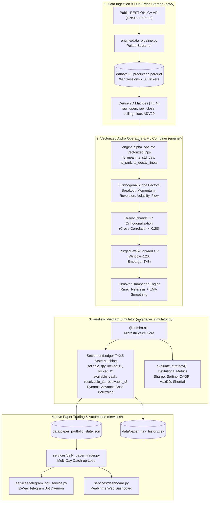

# System Architecture & Vietnam Equity Microstructure
**Lean VN-Quant: Institutional-Grade Quantitative Research & Execution Platform**  
**Classification:** Technical Whitepaper / Core Engineering Specification  
**Version:** 2.0 Production  

---

## 1. Executive Summary & Problem Formulation

Standard quantitative portfolio simulators (e.g., Backtrader, Zipline, VectorBT) are architected around frictionless, mature equity markets (such as the US NYSE/NASDAQ). Deploying these conventional models on the **Ho Chi Minh Stock Exchange (HOSE)** leads to catastrophic backtest overfitting and rapid live capital decay due to three distinct structural frictions:

1. **Strict $T+2.5$ Settlement Lag:** Equities purchased on day $T$ only settle and become tradable in the afternoon session of day $T+2$. Morning ATO selling before settlement constitutes illegal short-selling under State Securities Commission (SSC) regulations.
2. **Asymmetric Transaction Frictions:** Round-trip brokerage commission ($0.15\%$), personal income tax on gross sales ($0.10\%$), execution slippage ($0.10\%$), and dynamic sales proceeds advance borrowing interest ($0.035\%/\text{day}$).
3. **Exchange Price Limits & Liquidity Traps:** Strict $\pm 7\%$ daily price bands with zero-bid (floor trapped) and zero-ask (ceiling locked) liquidity phenomena.
4. **Discretization Constraints:** Compulsory round-lot discretization ($100$ shares), generating severe cash drag for sub-$1\text{B}$ VND accounts.

**Lean VN-Quant** resolves these frictions through a zero-dependency, C-speed execution engine built with pure Python 3.11, Numba JIT, and Polars Parquet storage.

---

## 2. End-to-End System Architecture

---

## 3. Data Pipeline & Dual-Price Architecture

### 3.1. Zero-Dependency Ingestion
To eliminate the brittle third-party dependencies frequently observed in domestic libraries (e.g., `vnstock` dependency conflicts), data ingestion is executed directly against Entrade/DNSE REST endpoints with automatic exponential backoff and deterministic fallback generation.

### 3.2. Dual-Price Separation
- **`adj_close` (Adjusted Close):** Used strictly for cross-sectional factor ranking and continuous indicator computation (`ts_mean`, `ts_std_dev`, `ts_decay_linear`) to prevent artificial split/dividend distortion.
- **`raw_open`, `raw_close`, `raw_high`, `raw_low`:** Used strictly for order execution, lot size allocation, and Mark-to-Market cash accounting, ensuring zero forward-looking leakage.

### 3.3. Point-in-Time (PIT) Financial Alignment
Adhering to Circular 96/2020/TT-BTC, quarterly financial disclosures are joined backward using `join_asof(by="symbol")` matching strictly against publication dates, preventing post-announcement information contamination.

---

## 4. Vectorized Mathematical Operators (AlphaLib)

The mathematical operator library in `engine/alpha_ops.py` implements industry-standard quantitative formulations across 2D NumPy matrices of shape $(T, N)$:

| Operator | Mathematical Definition | Implementation Details |
| :--- | :--- | :--- |
| `rank(x)` | Percentile cross-sectional rank $\in [0.0, 1.0]$ | Mask-aware, ignores halted/non-tradable stocks |
| `ts_rank(x, d)` | Rolling time-series percentile rank over window $d$ | Uses Bottleneck rolling ranks, $0\%$ look-ahead |
| `ts_decay_linear(x, d)` | $\sum_{i=1}^d i \cdot x_{t-d+i} / \sum_{i=1}^d i$ | Linear weight vectorization with Bottleneck acceleration |
| `ts_std_dev(x, d)` | $\sqrt{\frac{1}{d-1} \sum_{i=0}^{d-1} (x_{t-i} - \bar{x})^2}$ | Resilient against flat sessions ($\sigma \to 0$) |
| `group_neutralize(x, g)` | $x_{i} - \mathbb{E}_{j \in G_k}[x_j]$ | Cross-sectional sector neutralization |

---

## 5. Vietnam Microstructure Simulation Engine

The execution core in `engine/vn_simulator.py` is compiled with `@numba.njit` for C-speed performance:

### 5.1. T+2.5 Settlement State Machine
For every asset $i$, position holdings are segregated into three buckets:
- $S_i(t)$: **Sellable Quantity** (tradable in morning ATO).
- $L1_i(t)$: **Locked T+1 Quantity** (arriving tomorrow afternoon).
- $L2_i(t)$: **Locked T+2 Quantity** (purchased today, arriving in 2 business days).

Cash receivables follow identical settlement dynamics:
$$\text{Cash}_{\text{avail}}(t+1) = \text{Cash}_{\text{avail}}(t) + \text{Receivable}_{T+1}(t) - \text{BuyOutlay}(t)$$
$$\text{Receivable}_{T+1}(t+1) = \text{Receivable}_{T+2}(t)$$
$$\text{Receivable}_{T+2}(t+1) = \text{NetSellProceeds}(t)$$

### 5.2. Advance Cash Borrowing Mechanics
If today's buy order outlay exceeds $\text{Cash}_{\text{avail}}$, capital is drawn against pending sales receivables with dynamic borrowing interest:
$$\text{Fee}_{\text{advance}} = \sum_{\tau=1}^2 \text{Borrow}_{\tau} \times r_{\text{adv}} \times \tau, \quad \text{where } r_{\text{adv}} = 0.035\%/\text{day}$$

### 5.3. Conservative Liquidity Traps
- **Ceiling Lock ($\text{Open} \ge \text{Ceiling}$):** Buyer orders are refused ($0$ fill) to eliminate chase bias during locked limit-up sessions.
- **Floor Trap ($\text{Open} \le \text{Floor}$):** Sell orders are refused ($0$ fill) and held for the subsequent session, replicating authentic zero-bid trapped market microstructure.
